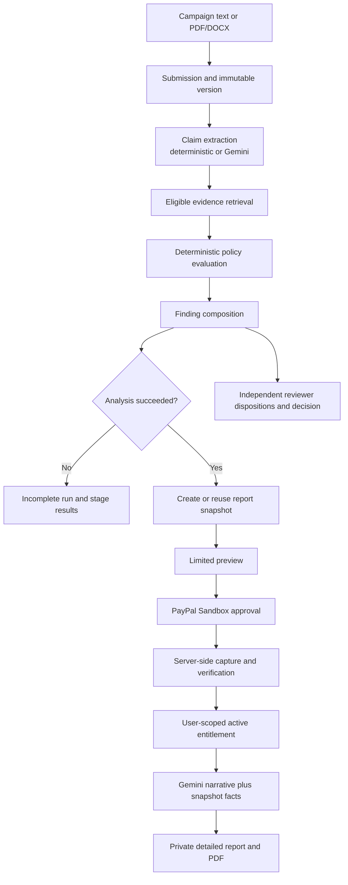

# VerityAI

VerityAI is a review workspace for checking claims made in financial marketing. It helps teams connect submitted campaign content to eligible evidence, apply configured policy checks, record reviewer decisions, and share a traceable verification report.

The project is a hackathon-stage demonstration. Its local development identity is not production authentication, and payments run through PayPal Sandbox only.

## What it does

- Accepts pasted campaign text and PDF/DOCX documents.
- Extracts claims, finds tenant-scoped eligible evidence, evaluates configured policy rules, and composes findings.
- Shows analysis stages and findings in a reviewer workspace; supports reviewer dispositions and decisions.
- Creates an immutable report snapshot after a successful analysis run.
- Offers a limited preview and PayPal Sandbox checkout for the full report.
- Generates an explanatory narrative after verified payment and provides a private PDF download.
- Provides evidence lifecycle and governance views for the seeded demo workspace.

## Technology

- **Backend:** Python, FastAPI, SQLAlchemy, Alembic, PostgreSQL, Pydantic.
- **Frontend:** React, TypeScript, Vite, React Router.
- **AI:** Google GenAI SDK for optional Gemini claim extraction and paid report narrative generation.
- **Payments:** PayPal REST Orders API v2 in Sandbox mode.
- **Documents and PDF:** `pypdf` and `python-docx` for text extraction; ReportLab for detailed report PDFs.
- **Local infrastructure:** Docker Compose PostgreSQL and private filesystem document storage.

## Architecture and workflow



Submission analysis runs synchronously in the API process. It records claim extraction, evidence retrieval, policy evaluation, and finding composition as separate stages. A failed required stage produces an `Incomplete` analysis run; a report snapshot can be created only for a successful run. Report creation is independent of the reviewer's decision.

## Gemini and verification boundaries

Gemini is used in two places:

1. **Claim extraction:** `AI_PROVIDER=gemini` sends submitted or extracted text to Gemini for structured candidate claims. The backend maps returned claim text to exact source spans and rejects claims that are not verbatim source text. The local deterministic extractor remains the default when Gemini is not selected.
2. **Paid detailed narrative:** after the backend confirms an active entitlement for the requesting user, Gemini generates explanatory prose, claim analyses, risk assessment, and recommendations.

Gemini does not decide evidence eligibility, verification status, findings, scores, counts, evidence references, policy outcomes, payment status, or entitlement. The detailed report is composed from the saved report snapshot, and server-side validation checks that its deterministic fields still match that snapshot. AI-generated recommendations are labeled as guidance.

Gemini calls require a valid API key and internet access. For the currently demonstrated model configuration, set `GEMINI_MODEL` to `gemini-3.5-flash-lite` and `GEMINI_TIMEOUT_SECONDS` to `90`. Keep the API key in the backend environment only. Use synthetic or otherwise authorized data when sending content to Google.

## PayPal Sandbox and report access

The backend creates PayPal Orders v2 orders with `intent: CAPTURE`. It obtains OAuth credentials server-side, sends idempotency keys, and uses the configured server-side price (USD only; the default is $5.00). The frontend cannot set the authoritative amount or currency.

Returning from PayPal is not proof of payment. The backend captures the order with PayPal and verifies the stored order binding, capture and order status, amount, currency, and report association before persisting payment facts and granting an active entitlement to the purchasing user. The frontend displays paid access only after the backend confirms that entitlement.

Once entitled, the report page requests detailed report generation, displays its sections, and offers a PDF download. Each detailed report and PDF request checks tenant scope and the current user’s active entitlement. PDFs are stored in the configured private local document store and returned as non-cacheable downloads.

Relevant endpoints:

| Purpose | Endpoint |
|---|---|
| Create or reuse report snapshot | `POST /api/v1/organizations/{org_id}/workspaces/{workspace_id}/submission-versions/{version_id}/analysis-runs/{run_id}/reports` |
| Read preview or entitled snapshot | `GET /api/v1/organizations/{org_id}/workspaces/{workspace_id}/reports/{report_id}` |
| Create PayPal payment/order | `POST /api/v1/organizations/{org_id}/workspaces/{workspace_id}/reports/{report_id}/payments` |
| Capture payment | `POST /api/v1/organizations/{org_id}/workspaces/{workspace_id}/report-payments/{transaction_id}/capture` |
| Start or retry detailed report generation | `POST /api/v1/organizations/{org_id}/workspaces/{workspace_id}/reports/{report_id}/detailed-report` |
| Read detailed report status/content | `GET /api/v1/organizations/{org_id}/workspaces/{workspace_id}/reports/{report_id}/detailed-report` |
| Download private PDF | `GET /api/v1/organizations/{org_id}/workspaces/{workspace_id}/reports/{report_id}/detailed-report/pdf` |

## Configuration names

The root `.env.example` is a local template. If a root `.env` does not already exist, copy the template to that ignored path and review local settings. Never overwrite an existing `.env` or commit credentials. The table lists names and purposes only; it does not provide secret values.

| Variable | Purpose |
|---|---|
| `APP_ENV` | Enables the guarded local development identity and development seed commands. |
| `POSTGRES_DB`, `POSTGRES_USER`, `POSTGRES_PASSWORD`, `POSTGRES_PORT` | Configure the Compose PostgreSQL service. |
| `DATABASE_URL` | Backend and Alembic connection for the selected database. |
| `TEST_DATABASE_URL` | Dedicated PostgreSQL test database connection; tests require a database named `verityai_test` and do not fall back to `DATABASE_URL`. |
| `CORS_ALLOWED_ORIGINS` | Explicit browser origins for a separately hosted frontend. |
| `DOCUMENT_STORAGE_PATH`, `DOCUMENT_MAX_UPLOAD_BYTES`, `DOCUMENT_CHUNK_SIZE`, `DOCUMENT_CHUNK_OVERLAP` | Local document storage and extraction/chunking settings. |
| `DOCUMENT_TENANT_ORGANIZATION_ID`, `DOCUMENT_TENANT_WORKSPACE_ID`, `DOCUMENT_TENANT_MEMBERSHIP_ID` | Server-bound tenant settings for the knowledge-document ingestion API. |
| `AI_PROVIDER` | Chooses deterministic or Gemini claim extraction. |
| `GEMINI_API_KEY` | Backend-only Gemini credential. |
| `GEMINI_MODEL`, `GEMINI_TIMEOUT_SECONDS` | Gemini model and request timeout. |
| `PAYPAL_CLIENT_ID`, `PAYPAL_CLIENT_SECRET` | Backend-only PayPal Sandbox credentials. |
| `PAYPAL_BASE_URL` | PayPal API base; the adapter accepts the Sandbox API host only. |
| `REPORT_PRICE_AMOUNT`, `REPORT_CURRENCY` | Server-side report price settings; only USD is supported. |
| `VITE_API_BASE_URL` | Optional frontend API origin; leave blank for the local Vite proxy. |
| `VITE_ORGANIZATION_ID`, `VITE_WORKSPACE_ID`, `VITE_USER_ID` | Local frontend demo identity values returned by the development seed. |

The Vite environment file belongs at `frontend/.env.local`. Do not put Gemini or PayPal credentials in any `VITE_*` variable: Vite exposes those values to browser code.

## Windows PowerShell setup

### Prerequisites

- Python 3.12 or newer, available as `py`.
- Node.js 22.12 or newer and npm.
- Docker Desktop with Docker Compose.

### Configure and start PostgreSQL

From the repository root, create `.env` only if it does not already exist so you do not overwrite local credentials:

```powershell
if (-not (Test-Path .env)) { Copy-Item .env.example .env }
```

Review `.env` locally and configure the database connection, Gemini settings, and PayPal Sandbox credentials. Do not paste credential values into source files or commit them.

Start PostgreSQL:

```powershell
docker compose up -d postgres
docker compose ps
```

### Install Python dependencies and migrate the development database

From the repository root:

```powershell
py -3 -m venv .venv
.\.venv\Scripts\python.exe -m pip install -r backend\requirements.lock.txt -r backend\requirements-dev.txt
.\.venv\Scripts\alembic.exe -c backend\alembic.ini upgrade head
```

Alembic reads `DATABASE_URL` from the root environment. The command above migrates that configured database. Do not point it at production when preparing a local demo.

### Seed the local demo workspace

The seed is idempotent and refuses to run unless `APP_ENV` is explicitly set to development in the current PowerShell process. It prints local demo IDs as JSON; use those IDs in the frontend environment, not as credentials.

```powershell
$env:APP_ENV = 'development'
Push-Location backend
$demo = ..\.venv\Scripts\python.exe -m app.db.seed_demo | ConvertFrom-Json
Pop-Location
$demo | Format-List
```

Create or update `frontend/.env.local` with the seeded identity so the browser requests the correct tenant. Add or update these entries in the file, preserving any unrelated settings:

```dotenv
VITE_API_BASE_URL=
VITE_ORGANIZATION_ID=<organization_id from the seed output>
VITE_WORKSPACE_ID=<workspace_id from the seed output>
VITE_USER_ID=<user_id from the seed output>
```

For local development, Vite proxies `/api` to the backend, so `VITE_API_BASE_URL` stays blank. The backend uses local development identity headers and only permits that identity mode from loopback requests. Do not expose this unauthenticated development API to a public network.

### Start the backend and frontend

In a backend terminal at the repository root:

```powershell
$env:APP_ENV = 'development'
.\.venv\Scripts\python.exe -m uvicorn app.main:app --app-dir backend --reload --host 127.0.0.1 --port 8000
```

The API liveness endpoint is `http://127.0.0.1:8000/health/live`; readiness, including a PostgreSQL query, is `http://127.0.0.1:8000/health/ready`.

In another terminal:

```powershell
Set-Location frontend
npm ci
npm run dev
```

Open the Vite URL printed in the terminal, normally `http://127.0.0.1:5173`.

## Database creation and migrations

`docker compose up -d postgres` creates the development database configured by Compose. Apply application migrations with:

```powershell
.\.venv\Scripts\alembic.exe -c backend\alembic.ini upgrade head
```

Backend integration tests require a separate PostgreSQL database named `verityai_test`. Create it once in the Compose PostgreSQL container (the command reads the configured PostgreSQL role inside the container):

```powershell
docker compose exec postgres sh -c 'psql -U "$POSTGRES_USER" -d postgres -c "CREATE DATABASE verityai_test;"'
```

Set `TEST_DATABASE_URL` privately in the current PowerShell session to connect to `verityai_test`. To migrate that database, temporarily point `DATABASE_URL` at the same test connection. This PowerShell block restores or removes the process-level `DATABASE_URL` afterward without displaying it:

```powershell
$previousDatabaseUrl = $env:DATABASE_URL
try {
  $env:DATABASE_URL = $env:TEST_DATABASE_URL
  .\.venv\Scripts\alembic.exe -c backend\alembic.ini upgrade head
} finally {
  if ($null -eq $previousDatabaseUrl) {
    Remove-Item Env:DATABASE_URL -ErrorAction SilentlyContinue
  } else {
    $env:DATABASE_URL = $previousDatabaseUrl
  }
}
```

The test fixture checks the configured database name and fails unless it is exactly `verityai_test`; never use the development database for tests.

## Tests and production build

Run the full backend suite from the repository root after setting `TEST_DATABASE_URL` and migrating the dedicated test database:

```powershell
.\.venv\Scripts\python.exe -m pytest -c backend\pytest.ini backend\tests -q
```

Run frontend tests and the production build from `frontend`:

```powershell
npm test
npm run build
```

The backend suite includes database-backed PostgreSQL tests and mocked Gemini and PayPal interactions. Automated tests do not require live provider calls.

## Judge demonstration walkthrough

Use synthetic campaign copy and PayPal Sandbox buyer credentials. Do not use live payment credentials or real customer data.

1. Start PostgreSQL, apply migrations, and run the idempotent demo seed as described above.
2. Configure the backend with a valid Gemini API key and PayPal Sandbox client credentials. Set `AI_PROVIDER` to Gemini if you want the initial claim-extraction stage to use Gemini; the detailed narrative always requires Gemini after payment.
3. Start the backend and frontend on their local loopback addresses.
4. In the intake page, submit synthetic financial marketing text or a text-based PDF/DOCX. Wait for all required analysis stages to complete successfully.
5. In the Review Workspace, inspect stage results and findings. A successful run creates or reuses its report snapshot and exposes **View report** independently of **Submit decision**.
6. Open the report to inspect the limited preview and the $5 USD Sandbox checkout option.
7. Choose the checkout action and approve the order with a PayPal Personal Sandbox buyer. PayPal redirects to VerityAI; the backend then captures and verifies the order. The report unlocks only after the API confirms the active entitlement.
8. Wait for the detailed narrative to finish, inspect the snapshot-backed report sections, and download the PDF. If generation fails, use the report page’s retry action.
9. Return to the Review Workspace to record reviewer dispositions and a decision as a separate workflow.

## Limitations and disclosures

- **Sandbox only:** payments use PayPal Sandbox, not live PayPal transactions. The configured API host is restricted to Sandbox.
- **No webhooks:** capture is verified synchronously through the Orders API when the browser returns. Webhook receipt and signature verification are not implemented in this milestone.
- **Gemini dependency:** Gemini-powered claim extraction and detailed report generation require a valid backend API key, internet connectivity, and provider availability. Detailed narrative generation does not silently fall back to a local model.
- **Synchronous processing:** submission analysis and detailed report generation run in API requests rather than a background job queue. Slow provider or document processing can hold requests open.
- **No production authentication:** tenant headers and seeded identities support local development only. The API is not safe to expose publicly as an authenticated production service.
- **Hosted CORS caveat:** payment creation sends an `Idempotency-Key` header from the browser, while the current backend CORS allowlist does not include that header. The local same-origin Vite proxy avoids this restriction; a cross-origin hosted frontend may fail the payment preflight until CORS is updated.
- **Local file storage:** uploaded documents and detailed report PDFs use local filesystem storage. Shared object storage and production retention/backups are not implemented.
- **No OCR:** PDF/DOCX processing extracts embedded text only. Scanned-image OCR is unsupported; English is the documented input expectation.
- **Fixed currency:** report pricing supports USD only. The server owns the amount; clients cannot set it.

## Security notes

- Keep `.env`, `frontend/.env.local`, Gemini keys, PayPal credentials, and database connection details out of version control.
- Never put provider credentials in frontend source or `VITE_*` variables.
- Use only synthetic or authorized content for provider-backed demonstrations.
- Keep the development backend bound to loopback and do not treat development identity headers as authentication.
