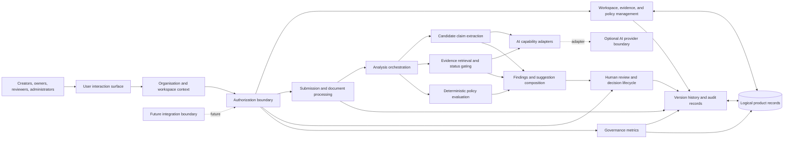
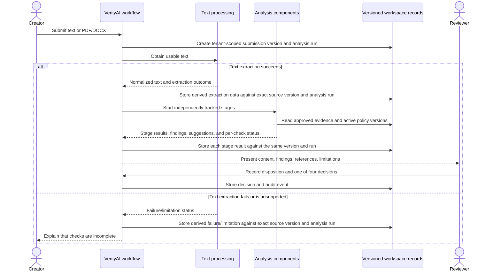
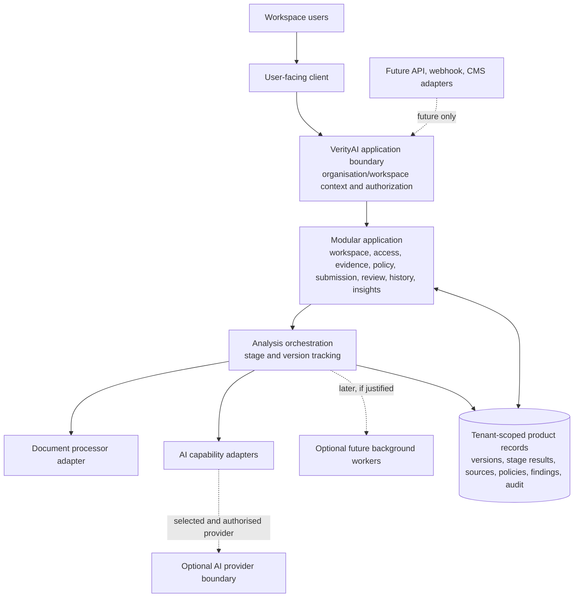

# VerityAI Product Architecture

## Document information

| Field | Value |
|---|---|
| Product | VerityAI |
| Document | Product Architecture |
| Version | 0.3 |
| Status | Draft for review |
| Product baseline | PRD v0.4 |
| Scope | Round 2 MVP and explicitly identified later phases |

This document translates the product requirements into a logical architecture. It does not select technologies, define database schemas or APIs, or resolve product decisions marked OPEN in the PRD.

### Revision history

| Version | Date | Summary |
|---|---|---|
| 0.3 | 2026-11-05 | Harmonised evidence lifecycle, freshness and re-approval rules with PRD v0.4; separated immutable submission sources from derived processing data; aligned governance metrics. |

## A. Architecture overview

### Product context and architectural objectives

VerityAI is a human-supervised system for reviewing claims in submitted marketing and business content against an organisation’s approved evidence and active policies. Its architecture must keep the relationship between a content version, its candidate claims, evidence and policy versions considered, findings, human dispositions, and final review decision traceable over time.

The Round 2 implementation may demonstrate one organisation and workspace, but the architecture treats organisation/workspace ownership as a first-class boundary and must accommodate multiple independent organisations. It starts as a modular monolith: logical responsibilities have clear boundaries while running together in one application. This keeps the MVP feasible for a solo hackathon developer and leaves independently deployable analysis or integration components as later options when workload or operational needs justify them. The design keeps deterministic checks, AI-assisted analysis, and human authority distinguishable, and records incomplete analysis so a partial result cannot look complete.

### System boundary

Inside the VerityAI boundary are organisation and workspace tenancy, workspace membership and authorization, evidence and policy records, submission versions, document intake and text extraction, analysis orchestration, candidate claims and matches, findings and suggestions, review decisions and dispositions, history, audit events, and the five MVP governance metrics. All tenant-owned records are scoped to an organisation and, where applicable, a workspace, even when the MVP contains only one of each.

People and organisation-provided material sit outside the system boundary: creators submit content; evidence owners supply and review sources; brand managers maintain policies; reviewers make decisions; and administrators manage workspace membership. A possible external AI service is a separate trust boundary if one is used. The PRD does not choose where analysis runs or which AI provider, if any, is used. Future APIs, webhooks, CMS connections, and other external services connect through explicit integration boundaries; none is part of Round 2. OCR, external monitoring, and identity-provider federation are also outside Round 2.

### High-level logical architecture

The diagram shows logical flows, not separate services or a selected storage or deployment product. AI capability adapters isolate the workflow from any provider; an external provider is optional and subject to the data-handling decisions in the PRD. The integration boundary is an extension point only, not an MVP interface requirement.

### Major architectural principles

- **Versioned review context:** Every analysis and decision belongs to an immutable submission version and references the evidence and policy versions available to that analysis.
- **Evidence eligibility is deterministic:** Uploaded and Reviewed evidence are ineligible as approved support. Approved evidence is eligible only when no supplied validity bound blocks it and it is neither Inactive nor Conflict-flagged. Missing validity information is freshness unknown; by itself it does not block otherwise eligible Approved evidence and must be disclosed. A supplied future effective date or passed expiry date blocks eligibility. A candidate match is not proof.
- **Separate results from authority:** Extracted claims, retrieval candidates, deterministic policy outcomes, AI-generated suggestions, human dispositions, and review decisions remain distinct records or result types.
- **Explicit completeness:** Each analysis stage has a result or an explicit limitation/failure state. Unrun or failed checks are never represented as passed.
- **Human-controlled outcomes:** Only an authorised reviewer records a terminal review decision. Approval with documented exceptions preserves unresolved status and the human rationale; it does not certify a claim.
- **Tenant context first:** Every organisation-owned record and operation has an organisation context and, where applicable, a workspace context. One-tenant demonstration does not remove tenant scoping.
- **Roles separate from permissions:** Workspace membership receives zero or more role assignments; roles group permissions, and authorization evaluates permissions for the requested action and resource. Product decisions about simultaneous assignments remain OPEN.
- **Replaceable capabilities:** Analysis stages depend on provider-neutral AI and document-processing boundaries, not on a specific model, provider, parser, or file format.
- **Small modular core:** Keep domain modules together in one deployable application for the MVP, with explicit boundaries that can be separated later without requiring microservices now.

## B. Logical components

These components are responsibilities within the product. The MVP may implement them as modules in a single application.

| Component | Responsibility | MVP notes |
|---|---|---|
| Organisation and workspace management | Create and maintain organisations and workspaces, associate members and product records, and establish tenant context | The demo may contain one organisation/workspace; entity ownership and access boundaries support multiple independent organisations |
| Identity and workspace membership | Establish the authenticated user context and associate the user with one or more organisations/workspaces according to membership | Authentication method and whether identities may span organisations are OPEN |
| Role and permission authorization | Resolve workspace-scoped role assignments into permissions and authorize each action against its resource and tenant | Roles are distinct from permissions. MVP can use predefined roles; simultaneous role assignments and precise grants remain OPEN |
| Evidence management | Register source/reference and owner, manage primary lifecycle and independent conditions, validity, versions, and manual conflict flags | Primary lifecycle is Uploaded, Reviewed, Approved; Inactive, Expired, and Conflict-flagged are independent conditions. Upload never implies approval. Missing validity is freshness unknown; validity edits create a version and require explicit re-approval before that revised version is eligible. The revised version's primary lifecycle treatment and authority for clearing Inactive remain OPEN |
| Policy management | Maintain policy records, Draft/Active/Retired status, rule details, and versions | Active policy versions are evaluated; only explicit deterministic MVP rules are automated |
| Content submission and document intake | Preserve exact submitted text or a reference to the original uploaded document as an immutable source version, with submitter, workspace, timestamp, version identity, and integrity reference; invoke a replaceable processor | MVP supports pasted text and PDF/DOCX; no OCR requirement. Extraction status and content are not mutable fields of the source snapshot |
| Document-processing adapter | Validate supported input and return normalized text, source locations when available, and explicit extraction status as derived processing data associated with the exact version and analysis run | MVP needs only extractable PDF/DOCX text; future OCR/formats can be added behind this boundary |
| Analysis orchestration | Create an analysis run for a fixed submission version, track independent stages, and collect outcomes | Runs inside the MVP application; stage state is designed to support later worker execution |
| Candidate claim extraction | Identify candidate factual and promotional claims and locate their text spans when available | AI-assisted; omissions and false candidates are possible and reviewable through human notes/dispositions |
| Evidence retrieval and matching | Search eligible evidence and return candidate source matches and provenance | Matching may use AI-assisted analysis, but primary lifecycle, validity-bound, Inactive, and Conflict-flagged eligibility gates are deterministic; unknown freshness is disclosed and alone does not block otherwise eligible Approved evidence |
| AI capability boundary | Define provider-neutral operations and result shapes for claim extraction, optional semantic matching, and suggestions; route to an adapter | No provider is selected. Replacing a model/provider should not alter workflow or domain result types |
| Deterministic policy evaluation | Apply configured terminology and messaging rules to extracted text and identify applicable rule versions | No broad semantic judgment is represented as a deterministic violation |
| Findings and suggestions | Compose structured findings from claim, retrieval, policy, eligibility/freshness, and completeness outcomes; optionally provide correction suggestions | Unknown freshness and date-based ineligibility are explained in source/review context. Suggestions are labelled as generated and are not verified facts or approved policy |
| Human review and approval | Present a version’s content, findings, references, and limitations; record reviewer dispositions and one of four review decisions | Approval with documented exceptions requires disposition and rationale for each unresolved finding |
| Version history and audit records | Preserve content, analysis, source/policy references, status changes, actors, timestamps, and decisions | Must support explanation of prior reviews; retention and hard-deletion policy remain OPEN |
| Governance insights | Aggregate workspace review events into five direct-count MVP metrics | No predictive scoring; recurrence is at least two policy/rule findings within the selected period |
| Integration boundary | Provide a future connection point for external requests, event notifications, CMS, and other services | Not implemented in Round 2; integration authentication, contracts, event delivery, and access scope remain future decisions |

### Module boundaries and deployment evolution

The MVP keeps the organisation/workspace, authorization, evidence and policy lifecycle, submission/version, review, audit, and governance modules together in one modular monolith. This keeps core state changes and review history straightforward for a solo developer.

Document processing and each analysis capability are isolated behind narrow logical contracts. In the MVP, the orchestrator can invoke them within the application. If usage or latency later warrants it, document processing, claim extraction, evidence retrieval, policy evaluation, or suggestion generation can move to independently deployable workers while retaining the same submission-version and stage-result contracts. They do not need to be separate services unless a measured operational reason justifies the additional deployment and monitoring cost.

AI provider adapters and document-format processors are replaceable implementations of capability boundaries. API, webhook, and CMS adapters can be added later at the integration boundary. The core review lifecycle does not depend on an integration or provider-specific behavior.

## C. Component interaction

### 1. Organisation and workspace setup

An organisation administrator creates or opens an organisation and its workspace, adds members, and assigns available workspace roles. Each subsequent request carries an organisation, workspace, and user context through the authorization boundary. The system checks tenant membership and the permissions derived from workspace-scoped role assignments before reading or changing records. The demo has one organisation/workspace; the same ownership model supports additional independent organisations. The exact authentication method, simultaneous role assignment policy, identity membership across organisations, and submission visibility rules remain OPEN.

### 2. Evidence and policy registration

An evidence/product owner registers a source or reference within the current organisation/workspace with its owner and any known validity dates. Its primary lifecycle starts in **Uploaded**; upload never implies review or approval and it cannot support claims. An authorised owner records inspection to move it to **Reviewed**, then explicitly approves it to reach **Approved**. **Inactive**, **Expired**, and **Conflict-flagged** are independent conditions, not primary lifecycle states. Setting or clearing Inactive never changes the primary lifecycle; the authority for clearing it is OPEN. An explicit manual conflict flag blocks eligibility; the MVP does not automatically discover evidence conflicts.

Eligibility is assessed deterministically at the relevant analysis time. A supplied future effective date or passed expiry date blocks eligibility. Missing validity information is represented as **freshness unknown** and does not, by itself, block otherwise eligible Approved evidence; the interface and review explanation disclose that uncertainty. A validity-date change creates a revised evidence version, which remains ineligible until explicitly re-approved. Evidence and metadata edits retain prior versions and review references. The primary lifecycle state assigned to a revised version after validity changes, and who may clear Inactive, remain OPEN; this architecture does not infer either rule.

A brand manager or administrator creates a policy record and its rule text. Draft policies do not run. Publishing an active policy creates an identifiable policy version. Retired policies do not run on new analysis. Policy authorisation and effective-date details are partly OPEN; the architecture preserves versions without assigning precedence among conflicting rules.

### 3. Content submission

A creator submits pasted English text or a PDF/DOCX document into the workspace. The submission is associated with the actor, organisation, workspace, time, and an immutable submission version. A revision creates a new version linked to the earlier one; it never overwrites the earlier content or review context.

### 4. Document text extraction

Pasted text enters analysis directly. A PDF/DOCX passes through the selected document-processing adapter and text extraction. The intake component records whether usable text was obtained. Unsupported or unreadable documents and extraction failures receive an explicit limitation and do not proceed as if all checks passed. OCR is not part of the MVP. Future processors, including OCR or other formats, can return the same normalized content and status contract without changing submission, review, or version lifecycle. Whether a reviewer may proceed with a recorded limitation is OPEN.

Each submission version has a separately identifiable analysis run. The run tracks extraction, claim extraction, evidence retrieval/matching, deterministic policy evaluation, finding composition, and optional suggestion generation as independently reported stages. Each stage result records its state and links back to the submission version and the relevant evidence/policy versions. The PRD requires incomplete checks to remain visible but does not prescribe internal stage-state names; exact retry, timeout, and cancellation behavior remains a later design decision.

For Round 2, the orchestrator may execute these stages within the application process. The logical contract does not require the request to wait for every analysis stage: the submission can be represented as processing/incomplete while results are recorded. If workload justifies it later, the same stages can be dispatched to background workers. Worker placement must not change tenant scope, stage meaning, version association, or the rule that failed and unrun stages cannot appear passed.

As an internal architecture proposal, each stage can have a small lifecycle such as **Not started**, **Running**, **Succeeded**, **Failed**, or **Not run** (with its dependency/limitation recorded). These names are not new user-facing PRD states. A stage’s result and owning analysis run remain queryable independently. Analysis is complete only when every required stage succeeds; a failed or unrun required stage leaves it incomplete. Optional suggestion failure does not invalidate completed required checks. A re-run creates a separate analysis attempt so previous results remain explainable; automatic retry policy and user-visible progress semantics remain OPEN.

### 5. Claim extraction and evidence matching

When text is available, the orchestrator requests candidate claims through the provider-neutral AI capability boundary and retains their wording and text locations when available. For each candidate claim, evidence retrieval searches only evidence with primary lifecycle state **Approved**, no supplied validity bound that blocks use at the analysis time, and neither **Inactive** nor **Conflict-flagged**. **Expired** is derived when a supplied end date has passed; a supplied future effective date also blocks use. Missing validity information is freshness unknown, not Expired, and does not alone exclude otherwise eligible Approved evidence; the unknown must be shown in source/review context. Retrieval returns candidate matches with source identity and match basis for human inspection. Provider/model selection is isolated in an adapter; the orchestration and finding contracts do not depend on one AI provider.

When no eligible candidate is found, the result is **Unverified — no approved evidence found**. It is not labelled false. Expired, not-yet-effective, Inactive, or manually Conflict-flagged records may be shown as context, but not as approved support. Approved evidence with unknown freshness may remain eligible, with its unknown freshness disclosed. The MVP does not automatically discover contradictory sources.

### 6. Deterministic policy evaluation

The evaluator applies the active policy versions and configured explicit rules to the available text. Each result points to the policy/rule version. Incompatible outcomes from configured deterministic rules are surfaced as a policy conflict. A user may also manually flag ambiguity. The system does not silently choose a precedence or automatically infer general policy ambiguity. This deterministic module is independent of AI-provider adapters and can execute when an AI-assisted stage fails, provided its text and policy inputs are available.

### 7. Finding generation and presentation

The finding composer combines structured outcomes into findings associated with claim spans, source records, policy versions, or analysis limitations. It distinguishes supported match found, unverified, potentially outdated, manually flagged evidence conflict, policy finding, policy ambiguity/conflict, and analysis limitation. Each finding includes affected content and an explanation, with a source or policy link when applicable or an explicit statement that no basis was found.

An optional AI-assisted correction suggestion is kept separate from the finding’s evidence and policy basis. It is labelled as a suggestion and remains unapproved. If a supporting explanation or check cannot be produced, the system states that limitation rather than fabricating it.

### 8. Human review and approval

An authorised reviewer examines the exact submission version, findings, source and policy references, and incomplete-check notices. The reviewer may record **Changes requested**, **Approved**, **Approved with documented exceptions**, or **Rejected**. A standard Approved decision applies when no findings remain unresolved. Approval with documented exceptions requires a disposition and rationale for each unresolved finding; those findings remain visibly unresolved. The review decision, actor, time, rationale, and version are preserved.

Only an authorised reviewer may make the decision. Which roles can act as reviewers, whether an administrator may override a decision, and whether a terminal decision may be reopened are OPEN. Approval triggers no publication or distribution.

### 9. Revision and resubmission

After Changes requested, the creator edits the content and submits a new version. The analysis runs again for that version. The prior version, findings, dispositions, references, and decisions remain available according to access and retention rules. Rejected and approved versions are terminal under the specified lifecycle; any reopening or correction procedure is subject to OPEN product decisions.

### 10. Governance insight generation

The governance component reads recorded workspace events for the selected organisation/workspace and period and derives exactly these MVP metrics:

1. Submission and review counts: submitted content versions and recorded review decisions in the selected period; each resubmitted version and each decision event counts once.
2. Unverified claims: claim instances with an analysis result showing no eligible Approved evidence match; a claim in a new submission version is a new instance.
3. Recurring policy findings: findings by policy/rule identifier in the selected period; recurrence means at least two findings for the same identifier.
4. Review decision trends: counts by decision type—Approved, Approved with documented exceptions, Changes requested, and Rejected—in the selected period.
5. Evidence requiring attention: Uploaded and Reviewed primary lifecycle states awaiting a decision, plus the independent conditions Expired, Inactive, and Conflict-flagged. A record can appear in multiple condition counts; the condition counts are not summed as a distinct-record total. Unknown freshness is disclosed but is not automatically Expired or ineligible; whether it needs its own attention count remains OPEN.

The five metrics are exactly the PRD v0.4 §16 definitions: submission and review counts; unverified claims; recurring policy findings by policy/rule identifier (recurrence requires at least two findings); review decision trends for all four decisions; and evidence requiring attention as defined above. Each metric shows the period and reflects only records visible to the user. Counts can include multiple versions of the same content. Insights describe recorded VerityAI activity and do not change policies, evidence, or review outcomes. Metric date/state-window semantics and whether unknown freshness receives a separate attention count remain OPEN as in the PRD.

### Future integration connections

Future APIs, webhooks, CMS connections, and external services enter through a separate integration boundary rather than calling internal modules directly. An integration adapter would translate an external request or event into the existing tenant-scoped submission, review, or notification concepts and would use the same authorization checks and version history. Outbound events would likewise report existing domain events rather than create a second source of review state. No API, webhook, CMS behavior, publication action, or external event delivery is part of the MVP. Integration identity, authorization, event contracts, retries, delivery guarantees, and data disclosure are OPEN for a future design.

### Main analysis and review sequence

The final branch does not decide whether the reviewer may proceed with a partially analysed version; that remains OPEN in the PRD.

## D. Data architecture

The following are conceptual entities and relationships, not a database schema.

| Conceptual entity | Purpose and relationships |
|---|---|
| Organisation / tenant | First-class customer isolation boundary. It owns one or more workspaces and all tenant-level records. The MVP demonstrates one organisation but the conceptual model is not limited to one. |
| Workspace | A work area within an organisation that scopes memberships, submissions, evidence, policies, review history, and insights. Every workspace-owned record has both tenant and workspace ownership. The MVP uses one workspace; whether additional workspaces per organisation are enabled is OPEN. |
| User identity | A person who may participate in one or more workspace memberships. Authentication and whether an identity can span organisations are OPEN. |
| Workspace membership | Associates a user with a workspace and membership status. It is the scope for role assignments and authorization; it does not embed a single role field. |
| Role assignment | Associates a membership with zero or more roles, with assignment history. This supports multiple workspace-scoped role assignments; whether the MVP permits simultaneous assignments remains OPEN under PRD §5/§11. |
| Role | A named grouping of permissions. MVP roles can be predefined (creator, brand manager, evidence/product owner, compliance reviewer, organisation administrator); the model does not require role names to be hard-coded into record ownership or business logic. |
| Permission | A separately named action/resource capability, such as managing evidence, editing policies, reviewing a submission, or viewing an insight. Authorization maps roles to permissions and checks them in the relevant organisation/workspace context. |
| Role definition / permission mapping | Maintains which permissions are granted by a role. Predefined mappings serve MVP; a future custom-role capability can add role definitions and mappings without changing membership or protected-resource ownership. Whether custom roles are needed and which permissions are delegable are OPEN. |
| Submission | A tenant- and workspace-owned content review case that groups one or more content versions and their analysis and review history. |
| Submission version | Immutable exact submitted text or reference to the original uploaded document, tenant/workspace, submitter, submission timestamp, version identity, and integrity reference. Each material content revision is a new immutable version linked to the prior version. Extraction status and analysis outputs are not part of this source snapshot. |
| Derived processing data | Extracted/normalized text, extraction status and warnings, candidate claims, evidence matches, policy results, findings, suggestions, and stage outcomes; each is associated with the exact immutable submission version and relevant analysis run. Failure or incomplete status remains explicit and cannot be represented as a completed/passed check. |
| Extracted claim | Candidate claim text and optional location within one submission version, associated with its analysis run. It is derived analysis data, not part of the immutable submitted source or an authoritative fact. |
| Evidence record | Tenant/workspace-owned source identity, owner, primary lifecycle state (Uploaded, Reviewed, Approved), independent conditions (Inactive, Expired, Conflict-flagged), validity metadata, and history. |
| Evidence version | A versioned source and metadata snapshot. An analysis and review point to the version used so later changes do not rewrite earlier basis. Validity edits create a revised version, which remains ineligible until explicit re-approval. Its primary lifecycle state before re-approval remains OPEN. Manual conflict flags and their changes are traceable. |
| Policy | Tenant/workspace-owned organisational guidance/rule grouping with category and lifecycle. |
| Policy version | Versioned rule text, status, and applicable configuration used by a specific analysis. Draft and retired versions do not run for new checks. |
| Analysis run | A unique analysis attempt associated with exactly one immutable submission version and its tenant/workspace. It tracks overall status without obscuring stage outcomes. |
| Analysis stage result | One independently tracked extraction, claim extraction, retrieval/matching, policy evaluation, finding composition, or suggestion stage, with state, output/reference, and failure/limitation details. Each result belongs to an analysis run and therefore a submission version. |
| Evidence match candidate | A relation between an extracted claim and a candidate evidence version with provenance and match explanation. A match is not proof. |
| Finding | An explainable issue or status tied to a submission version and, where relevant, a claim, evidence version, policy version, or incomplete check. |
| Generated suggestion | Optional proposed wording linked to a finding/version and labelled as unverified generated assistance. It is not an evidence or policy record. |
| Human disposition | A reviewer’s recorded response to an individual finding, with actor, time, and rationale. It supplements and does not erase the original finding. |
| Review decision | One of Changes requested, Approved, Approved with documented exceptions, or Rejected for an exact submission version, with reviewer and rationale as required by PRD §15. |
| Audit event | Tenant/workspace, actor, time, action, target record/version, and relevant change context for material evidence, policy, membership, submission, analysis, and decision events. Exact audit scope for denied attempts and retention are OPEN. |

### Relationships and historical traceability

- An organisation is the tenant boundary and owns its workspaces. A workspace is a subordinate access/operational scope. All tenant-owned records carry tenant ownership, and workspace-owned records carry both tenant and workspace ownership.
- Tenant context is resolved before resource access and is applied to reads, writes, search, background work, metrics, and future integrations. A background stage cannot rely only on an untrusted workspace identifier supplied with a task; it must preserve and validate the owning tenant context.
- Membership belongs to a user and workspace. Role assignments belong to that membership; a role maps to permissions. Resource authorization checks the resolved permission and tenant/workspace ownership, rather than comparing a single hard-coded role name.
- A submission groups ordered submission versions. Analysis runs, stage results, findings, dispositions, and decisions attach to a specific version, not to mutable current content.
- An analysis run references derived extraction data, candidate claims, evidence versions considered, policy versions evaluated, findings, suggestions, and each stage's completion state for exactly one immutable submission version. A retry or re-run is a distinct attempt; its exact user-visible semantics remain OPEN. Derived updates never overwrite the submitted source; failed extraction or incomplete checks remain explicit and cannot appear completed or passed.
- A finding can link to zero or more candidate evidence versions and/or one or more policy versions. Missing evidence is represented as an explicit unverified outcome, not as a false claim.
- Evidence and policy records have version histories. A later status or text change must not alter the source/rule basis preserved for an earlier review. A validity edit creates a revised evidence version, which remains ineligible until explicit re-approval. Its primary lifecycle state before re-approval remains OPEN.
- A review decision references one submission version and the findings/dispositions visible to its reviewer. Approval with documented exceptions preserves unresolved findings and their rationales.
- Audit events refer to actors and changed records. Their retention and deletion behavior must be set by policy; this architecture does not assume indefinite retention.
- Governance metrics are derived from tenant/workspace-scoped recorded submissions, claim outcomes, policy findings, decisions, primary evidence lifecycle states, and independent evidence conditions. Unknown freshness is disclosed and is not automatically Expired or ineligible. Metrics are not independent truth records and must not combine tenants unless an explicitly authorized cross-tenant reporting purpose is defined later.

## E. AI and analysis architecture

| Operation | Classification | Architectural treatment |
|---|---|---|
| Document intake and text extraction | Deterministic document processing through a replaceable processor | Produces normalized text or an explicit unsupported/unreadable/incomplete status; PDF/DOCX only for MVP, with no OCR requirement |
| Candidate claim extraction | AI-assisted | Produces candidate spans and may be incomplete or mistaken; human review can record missed or irrelevant candidates |
| Evidence candidate retrieval/matching | Retrieval with possible AI-assisted semantic analysis | Produces candidate sources and match explanations; only the deterministic gate determines eligibility: primary lifecycle Approved, no supplied date bound blocking use, and neither Inactive nor Conflict-flagged |
| Evidence status and validity checks | Deterministic | Keeps Uploaded/Reviewed/Approved primary lifecycle separate from Inactive/Expired/Conflict-flagged independent conditions; missing validity is unknown freshness, a future effective date or passed expiry blocks use, and unknown freshness alone does not |
| Policy evaluation | Deterministic in MVP | Applies explicit configured rules and links results to exact policy versions; no broad semantic judgment is represented as a deterministic violation |
| Evidence or general policy conflict discovery | Human-controlled in MVP | Evidence conflicts are manually recorded; policy ambiguity can be manually flagged or surfaced for explicit deterministic collisions. Automatic general detection is deferred |
| Finding composition | Structured system logic | Combines check results, source/policy references, and limitations into explainable findings without asserting factual truth |
| Correction suggestions | AI-assisted and optional | Clearly labelled suggestions, editable by the creator, never verified facts or approved policy |
| Human finding disposition | Human-controlled | Records a reviewer’s view and rationale without erasing automated output |
| Review decision | Human-controlled | Authorised reviewer chooses one of the four decisions; unresolved findings require explicit exception disposition and rationale |

Model confidence, retrieval similarity, or a generated explanation never proves factual accuracy. The architecture stores generated content as output with its origin, separate from source evidence and official policy. The PRD does not specify model provenance/version capture for MVP; recording configuration versions is next-release (NFR-009).

If an external AI service is considered, it must be treated as a separate trust boundary. Before using it, the product must resolve the PRD’s customer-content authorisation, disclosure, retention, residency, and security questions. This architecture does not assume that content may be sent to an external service or name a provider.

### AI provider independence

AI-assisted capabilities are invoked through provider-neutral capability contracts, such as “extract candidate claims from this normalized text” or “produce an optional correction suggestion for this finding.” A contract defines the input context, output shape, provenance, and explicit failure/incomplete result without exposing provider-specific request formats or response objects to the workflow.

An adapter translates between each supported provider/model and those capability contracts. The orchestration, deterministic evidence-status gate, policy evaluator, finding model, and review lifecycle consume the normalized capability result, not a provider SDK or model-specific output. This allows a provider/model to be replaced or another adapter to be added without rewriting the review workflow. It does not require multiple providers to run in MVP or prescribe automatic fallback, routing, or per-organisation model choice. Provider selection, configuration, and failure/fallback rules remain OPEN for later decisions.

### Replaceable document processing

Document intake is separated from document interpretation. A processor accepts an uploaded document and returns normalized text, any available source-location mapping, and a clear success, unsupported, unreadable, or failed status. Pasted text can enter the same normalized-content path directly. The MVP needs only the PDF/DOCX processing needed for extractable text.

Future OCR or additional document formats can be implemented as new processor adapters that produce the same normalized-content and status contract. Claim extraction, evidence matching, policy evaluation, findings, and human review consume that contract and therefore do not need restructuring when a processor changes. Format support, OCR scope, file limits, processing guarantees, and retention remain subject to product decisions and roadmap scope.

## F. Security and trust boundaries

### Organisation and workspace isolation

Organisation is the tenant isolation boundary; workspace is a subordinate operational and access scope. Each operation, stored product record, analysis stage, metric query, and future integration request carries its owning organisation context and (when applicable) workspace context. Every entity lookup or change must be constrained by that context, and a request lacking valid membership is denied. The MVP may contain one organisation, but the authorization and data model must not rely on that fact. Exact isolation controls are a later technical design decision.

### Role-based access enforcement

The permission boundary checks workspace membership, all applicable workspace-scoped role assignments, and the permissions granted by those roles before evidence, policy, submission, review, or insight operations. Roles are named groupings; permissions are separately represented actions on resources. MVP may expose only the predefined PRD roles. Future custom roles can be represented by additional role definitions and role-to-permission mappings, without changing membership assignments or tenant ownership. The system must not rely on the interface alone to hide unauthorized actions. Exact authentication, whether multiple roles may be assigned simultaneously in MVP, creator visibility of other submissions, brand-manager reviewer status, and administrator override/correction are OPEN and must not be assumed by this architecture.

### Content and evidence protection

Submitted content, source documents/references, findings, and review history are organisational information. They are available only to authorised users in the owning organisation/workspace according to the resolved permission rules. The PRD requires privacy and workspace access controls but leaves authentication, encryption, retention, deletion, data residency, and sensitive-data handling decisions OPEN. This document makes no security certification or encryption guarantee.

### Auditability and human authority

Material evidence, policy, membership, submission, and review changes retain actor and time. Analysis and review records preserve the versions considered. Human dispositions coexist with the original automated finding. A reviewer’s approval applies only to the version reviewed; approval does not publish content, remove unresolved status, or certify truth or compliance.

### External AI-service boundary

Any external AI service would receive data across a product trust boundary and could expose sensitive customer material. The provider-neutral adapter boundary keeps that choice replaceable, while tenant-specific data flow must remain explicit. Whether such a service is used, which provider/model is selected for each capability, what content is sent, what notice/authorization is required, and what retention or processing terms apply are unresolved. A later design must conform to decisions on customer-content use. No provider or protection guarantee is selected here.

## G. Failure handling and limitations

Analysis is represented as staged outcomes so individual checks can fail without making the whole result appear successful. A completed check may show its result even when another check is incomplete, but the analysis and submission remain visibly incomplete until all required checks have a result. Whether an authorised reviewer can proceed with an analysis-blocked version is OPEN.

| Condition | Required logical behavior |
|---|---|
| Unsupported or unreadable document | Record a user-understandable limitation. Do not claim content checks ran successfully. No OCR is assumed. |
| Text extraction failure | Record extraction as failed/incomplete, identify dependent checks as not run, and tell the creator that analysis is incomplete. |
| Missing approved evidence | Create an Unverified finding. Do not call the claim false. |
| Expired or inactive evidence | Show its condition as context and exclude it as current approved support; count it in the relevant Evidence requiring attention bucket. Setting or clearing Inactive never changes primary lifecycle. |
| Missing validity information | Disclose freshness as unknown; it is not automatically Expired or ineligible. Whether it receives a separate attention count remains OPEN. |
| Future effective date | Exclude the evidence at that analysis time and explain that the supplied validity period has not begun. |
| Validity-date update | Keep the revised evidence version ineligible until explicit re-approval; preserve earlier versions and review references. The revised version's primary lifecycle state before re-approval remains OPEN. |
| Manually flagged evidence conflict | Show the involved source and flag, exclude it from unqualified support, and route it for human assessment. MVP does not automatically detect conflicts. |
| Conflicting deterministic policy rules | Surface the collision and applicable policy versions for authorised human resolution. Do not silently select precedence. |
| AI or external service failure | Mark the affected AI-assisted check failed or incomplete. Independent deterministic policy checks may still run when usable text is available; the combined analysis remains visibly partial. Do not substitute a confidence value or fabricated result. |
| Claim extraction failure or no candidate claims | Record the extraction outcome explicitly. A no-claim result is distinguishable from a failed extraction; users may report missed claims through review notes. |
| Evidence retrieval failure | Mark evidence search incomplete, distinct from “no approved evidence found.” Do not turn a retrieval failure into an Unverified result that implies a successful search. |
| Policy evaluation failure | Mark the policy check incomplete, distinct from “no policy finding.” Do not report the policy check as passed. |
| Suggestion generation failure | Omit the optional suggestion and preserve the underlying findings. Do not block or misstate the review basis solely because a suggestion is unavailable. |
| Partial analysis | Show which stages completed, failed, or did not run. Do not show a passed/complete state for missing results. Reviewer continuation is subject to the OPEN approval rule. |

Where content is readable, independent analysis stages can be isolated so one failure does not erase valid results from another stage. The user interface and stored result must still state that the analysis is partial. This is a proposed failure-isolation behavior, not a new product capability.

## H. Deployment view

The following is a technology-independent logical view. It does not prescribe hosting, process count, frameworks, databases, queues, or AI vendors.

For Round 2, the modules, orchestrator, document processor, and AI adapters can run inside one application boundary. Analysis stages can execute in-process and update their independent statuses; no queue or worker infrastructure is required. At higher workload, selected stages may move to background workers that use the same versioned stage contracts and tenant context. External AI and integration adapters are optional/future boundaries, not MVP deployment requirements. A later design decides operational isolation, file handling, persistence, and external data flow without weakening tenant isolation or analysis-status reporting.

## I. Architecture decisions and unresolved questions

### Confirmed by the PRD

- The PRD’s Round 2 demo may use one organisation/workspace. This architecture treats organisation tenancy as first class and supports multiple independent organisations.
- Workspace membership scopes access. Role assignments are workspace-scoped and separated from permissions; the PRD leaves simultaneous role assignment behavior OPEN, while the architecture can represent multiple assignments.
- The MVP accepts pasted English text and PDF/DOCX, with analysis limited to extractable text and no OCR requirement.
- Evidence has primary lifecycle states Uploaded, Reviewed, and Approved and independent conditions Inactive, Expired, and Conflict-flagged. Upload never implies approval; Uploaded and Reviewed are ineligible. Approved evidence is eligible only when no supplied validity bound blocks use and it is neither Inactive nor Conflict-flagged. Missing validity is unknown freshness and alone does not exclude otherwise eligible Approved evidence; disclose it. Setting or clearing Inactive does not alter primary lifecycle. Expired evidence remains ineligible after validity edits until the revised version is explicitly re-approved.
- Evidence conflicts are manually recorded in the MVP. Automatic evidence conflict detection is next-release scope.
- MVP policy checks are explicit and deterministic. General automatic policy ambiguity detection is not in MVP.
- Every review decision refers to an exact content version, and the original findings remain available when a reviewer records a different disposition.
- The four reviewer decisions are Changes requested, Approved, Approved with documented exceptions, and Rejected. Exceptions preserve unresolved status and require per-finding rationale.
- Missing evidence means unverified, not false. AI confidence and matching similarity are not proof.
- Governance is limited to the five direct-count metrics defined in PRD §16. There is no automatic policy/evidence change or automatic publishing.

### Proposed architectural choices

These choices organize the confirmed requirements without selecting implementation technology:

1. **Start as a modular monolith.** This reduces operational work for a solo developer while retaining clear responsibility boundaries. Nothing requires microservices for the MVP.
2. **Make analysis a persisted, independently tracked stage workflow.** Stages can execute in-process now and move to background workers later without changing their result or version contracts.
3. **Make tenant ownership explicit in every protected record and operation.** A one-organisation demo must not become an assumption in authorization or data access.
4. **Separate role assignments from permissions.** Workspace-scoped memberships can carry multiple role assignments; roles map to separately represented permissions. Predefined MVP roles and later custom roles use the same model.
5. **Attach all analysis and decisions to immutable submission versions.** This follows the PRD’s historical traceability and revision requirements.
6. **Use version references for evidence and policy context.** A later source or rule update must not silently change the basis of an earlier review.
7. **Separate status gating from semantic matching.** A model or retrieval process may propose a candidate, but deterministic evidence status and validity rules decide whether it can be considered current approved support.
8. **Place AI and document processing behind replaceable capability boundaries.** Providers, models, and processors can change without rewriting orchestration or review lifecycle.
9. **Compose findings from explicit typed outcomes and derive insights from recorded events.** Missing sources, expired evidence, conflict flags, policy collisions, failed checks, and suggestions remain distinct; no predictive governance layer is needed for MVP.

### Decisions dependent on OPEN product questions

The following architectural details must remain configurable or undecided until product decisions are made:

- Which roles may review, whether brand managers may act as reviewers, and whether administrators can correct or override review decisions.
- Whether users may be assigned multiple roles simultaneously in the MVP, what creators can see across submissions, and which roles may see metrics and underlying records. The relationship model supports multiple assignments; this does not settle product permission policy.
- Whether reviewers may proceed when document extraction or another required analysis stage is incomplete.
- How finding attention labels are worded and what additional evidence metadata must be represented.
- Which policy categories, deterministic rule types, policy approval steps, applicability dimensions, and conflict-resolution ownership apply.
- How evidence conflict flags are explained, assigned, cleared, and retained.
- Who may clear the independent Inactive condition, and which primary lifecycle state applies to a revised evidence version after validity information changes and before explicit re-approval.
- Whether unknown freshness should have its own Evidence requiring attention count. Unknown freshness remains disclosed and is not itself Expired or ineligible.
- Metric date/state-window semantics for Unverified claims, recurring policy findings, and Evidence requiring attention.
- Retention, deletion, export, audit scope, authentication, encryption, data residency, incident handling, sensitive-data, and customer-content authorisation/processing rules.
- Document size/page limits, response/processing expectations, availability/accessibility targets, and evaluation targets.
- Whether a terminal decision may be reopened and whether an administrative correction path is allowed.
- Whether a user identity may span multiple organisations, whether an organisation may have multiple workspaces in the product, and how organisations/workspaces are provisioned and administered.
- Whether and when custom roles are needed, who may define them, and which permissions can be assigned.
- Whether AI providers/models may vary by capability or organisation, what fallback policy applies, and what data may cross an external provider boundary.
- Which future integration contracts, authentication, event delivery and retry guarantees, and CMS behaviors are required.
- What workload evidence would justify moving particular analysis stages out of the application, and what queueing, retry, ordering, and operational targets should then apply.

None of these items is silently resolved by the component or deployment views above.

## J. MVP architecture boundaries

### Required for Round 2

- A demo may contain one organisation/workspace, while all tenant-owned records, access checks, analysis runs, and insights carry organisation/workspace context so adding independent organisations does not require redesigning the domain model.
- Workspace membership and basic role enforcement using predefined roles mapped to separate permissions. The membership model can represent multiple role assignments; whether the MVP enables simultaneous assignments remains OPEN.
- Evidence and policy registration, primary evidence lifecycle and independent conditions, version history, validity/freshness disclosure, and actor/time records. Follow PRD v0.4 eligibility and re-approval rules; retain the revised-version lifecycle treatment and Inactive-clearing authority as OPEN.
- Pasted text and PDF/DOCX intake with text extraction status; no OCR.
- Candidate claim extraction, evidence retrieval/matching, and explicit evidence eligibility checks.
- A small set of configured deterministic terminology and messaging checks.
- Structured findings, incomplete-check reporting, optional labelled correction suggestions, and review notes/dispositions.
- Human decisions and revision flow tied to immutable submission versions, including approval with documented exceptions.
- Review history, audit records, and the five direct-count governance metrics.
- Workspace isolation and role checks, subject to the OPEN permission matrix.

### Deferred to Round 3 / next release

- Automatic possible evidence contradiction detection.
- Richer claim classification and evidence matching/freshness analysis.
- Automated policy ambiguity detection and richer policy authoring/clarification workflow.
- Reviewer disagreement analytics and expanded governance filters/trends.
- More robust document ingestion and operational controls.
- Further role granularity and configurable review routing, subject to validation.

### Future roadmap

- Visual analysis, multilingual processing, CMS integrations, and monitoring of published content.
- Enterprise identity, retention, and administration capabilities beyond MVP needs.

The architecture does not introduce future capabilities into the MVP design. The Round 2 implementation can keep interfaces between responsibilities clear while building only the workflow required by PRD v0.4.

## K. Staged architecture evolution

| Stage | What changes | What remains stable |
|---|---|---|
| **Stage 1: Hackathon MVP** | Implement one modular monolith and one demonstration organisation/workspace. Use predefined role definitions and a small permission mapping. Execute independently tracked analysis stages in-process. Support pasted text and the MVP PDF/DOCX extraction path through one processor adapter. Use whichever AI capability is selected through a provider-neutral boundary. No background workers, tenant self-service, custom-role editor, public APIs, webhooks, CMS connection, or OCR are required. | Organisation/workspace ownership is present in records and authorization from the start. Submission versions preserve only the immutable submitted source and its identity/integrity context; derived extraction and analysis outputs are tied to the exact version and run. Evidence and policy versions, analysis stage results, findings, human decisions, and audit events retain their associations. Roles remain separate from permissions. AI and document-processing contracts remain independent of specific providers/processors. |
| **Stage 2: Multi-organisation product** | Operate multiple independent organisations and workspaces. Apply tenant context consistently to user membership, authorization, content and evidence access, search, analysis, audit, and governance metrics. Add organisation provisioning and administration only after product rules are defined. The data and role-assignment model can enable multiple workspace-scoped role assignments and, if approved, custom roles by adding definitions and permission mappings. | The organisation remains the tenant boundary and workspace remains a subordinate scope. Review lifecycle, version references, stage-result semantics, evidence eligibility including the distinction between known blocking dates and unknown freshness, human authority, and provider/processor boundaries remain unchanged. No custom-role feature is assumed until approved. |
| **Stage 3: Increased workload and independent processing** | When measured workload or processing needs justify it, move selected analysis stages from in-process execution to background workers. Scale or deploy document processing, claim extraction, retrieval, policy evaluation, or suggestion generation independently as needed; not every module must be separated. Add operational controls such as queueing, retry, concurrency, and monitoring only after targets and failure policy are defined. | Each stage remains linked to the same tenant-scoped analysis run and immutable submission version. Stage statuses, outputs, evidence/policy version references, findings, partial-analysis behavior, and review decisions keep the same meaning. Deterministic and human-controlled decisions remain separate from AI-assisted outputs. |
| **Stage 4: Enterprise integrations and governance** | Add approved APIs, webhooks, CMS and other enterprise connections at the integration boundary. Add enterprise identity and administration capabilities, configurable routing, and broader governance reporting only when product, security, and privacy requirements are resolved. Integrations may submit content or carry approved events, but publication and monitoring capabilities require separate product scope and authorization. | Integrations use the same tenant/workspace authorization, submission/version lifecycle, audit trail, evidence/policy references, and human decision model. No integration becomes a second source of review state; no cross-tenant data is combined without an explicitly approved purpose and access rule. |

This progression is evolutionary rather than a commitment to a service count. The modular monolith is sufficient for Stage 1. Boundaries make later deployment separation possible, but extraction into independent components is justified only by workload, reliability, operational ownership, or integration needs. Changes in execution location must preserve tenant ownership and the traceable claim-to-evidence-to-policy-to-human-decision chain.
