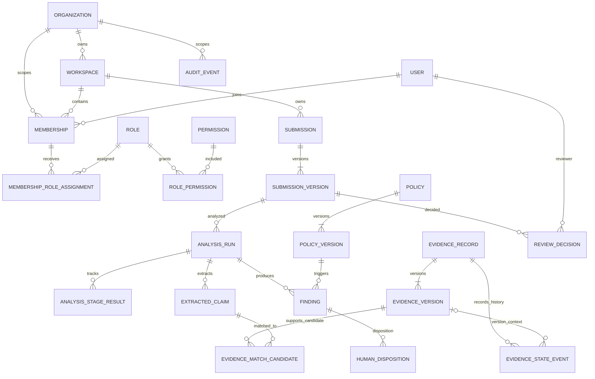
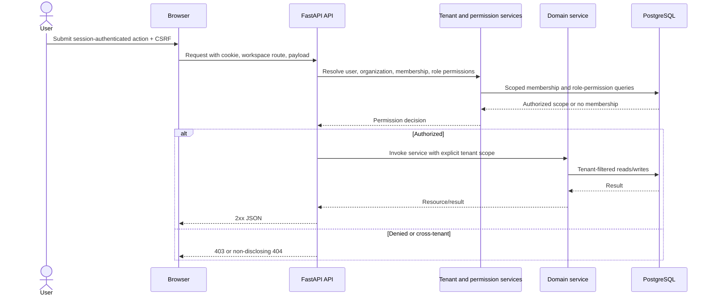

# VerityAI Technical Design

## 1. Document Information

| Field | Value |
|---|---|
| Product | VerityAI |
| Document | Technical Design |
| Version | 0.4 |
| Status | Proposed design for review; implementation is underway; no formal approval inferred |
| Product baseline | PRD v0.4 |
| Architecture baseline | Product Architecture v0.3 |
| Date | 2026-11-05 |
| Scope | Round 2 hackathon MVP, with explicit extension points |

### Revision history

| Version | Date | Summary |
|---|---|---|
| 0.1 | 2026-11-05 | Initial technical design proposal. |
| 0.2 | 2026-11-05 | Reworked the stack and implementation guidance for the solo hackathon MVP; strengthened tenant integrity, immutable processing records, public demo deployment, MVP prioritisation, and deployment/readiness wording. |
| 0.3 | 2026-11-05 | Harmonised evidence eligibility and validity re-approval with PRD v0.4; clarified record-level lifecycle versus version-specific approval history and gates; refreshed source baselines and OPEN decisions, evidence-attention metrics, and MVP boundary. |
| 0.4 | 2026-11-08 | Recorded the approved finding-disposition semantics, latest-disposition eligibility rule, append-only ordering, disposition API, and transaction-time approval revalidation. |

This design makes proposed technical choices under the product boundaries in the PRD and Product Architecture. A technical proposal that depends on an OPEN product decision is marked **GATED** and must not be implemented as a settled product rule until that decision is approved.

## 2. Technical Overview

### Technical interpretation

VerityAI is a tenant-scoped modular monolith for evidence-backed content review. It stores organisations and workspaces, approved source and policy versions, immutable submitted-content versions, independently tracked analysis stages, human dispositions and review decisions, and audit events. The Round 2 workflow can run in one application process with one relational database. Logical module and adapter boundaries allow selected processing stages to move later without changing the review lifecycle.

### Technical objectives

- Deliver the full Round 2 workflow with a small stack that one developer can understand and operate.
- Carry organisation and workspace ownership through every record, query, API authorization check, analysis run, audit event, and governance metric.
- Preserve the exact content, evidence, and policy versions used by an analysis or decision.
- Keep authentication, authorization, AI-assisted output, deterministic checks, and human decisions separate.
- Track extraction, claim analysis, evidence retrieval, policy checks, findings, and optional suggestions as distinct stage results.
- Avoid infrastructure that has no Round 2 requirement: no microservices, queue, vector database, CMS integration, public webhooks, or OCR.

### Key constraints and inherited decisions

- The Product Architecture chooses a modular monolith initially, supports multiple organisations conceptually, separates workspace-scoped roles from permissions, and requires replaceable AI and document-processing boundaries.
- The MVP accepts pasted English text and PDF/DOCX with extractable text. OCR is out of scope.
- Evidence conflict flags are recorded manually. General automated evidence conflict discovery and general policy ambiguity detection are deferred.
- Uploaded and Reviewed evidence are never eligible as approved support. Approved evidence is eligible only when neither Inactive nor Conflict-flagged and no supplied validity date blocks its use. Missing validity information is disclosed as unknown freshness but does not alone block otherwise eligible Approved evidence; a future effective date or passed expiry date blocks eligibility. A validity-date edit creates a revised version that remains ineligible until that exact version is explicitly re-approved.
- Human review has four decisions: Changes requested, Approved, Approved with documented exceptions, and Rejected. Approval with exceptions requires a disposition and rationale for each unresolved finding.
- No AI output is proof of factual accuracy. A missing match means unverified, not false. Nothing is published automatically.
- Open product questions include authentication, role grants, creator visibility, reviewer eligibility, administrator overrides, retention, external AI authorization, document limits, and behavior when required analysis is incomplete.

### What this document decides and what remains OPEN

This document proposes the implementation stack, relational entities, API conventions, module boundaries, hosted demo shape, and test approach. It does not decide unresolved user permissions, authentication policy, whether a reviewer may proceed after incomplete analysis, data retention, data residency, customer-content authorization, document limits, or production service levels. Where implementation depends on one of these, this document marks the relevant interface or rule **GATED**.

### Source-document dependencies to reconcile

PRD v0.4 and Product Architecture v0.3 are the current product and logical architecture baselines. They distinguish primary evidence lifecycle states (`Uploaded`, `Reviewed`, `Approved`) from independent conditions (`Inactive`, `Expired`, `Conflict-flagged`), allow unknown freshness without automatic exclusion, require explicit re-approval after validity-date edits, and separate immutable submission sources from derived analysis data. This design follows those rules while leaving the revised evidence version's primary lifecycle state before re-approval **OPEN**. The PRD and Product Architecture retain draft/review statuses; this proposed Technical Design does not claim formal product approval.

## 3. Technology Stack and Justification

Technology versions below are the versions or release lines selected for implementation planning, not packages installed in this task. Recheck patch releases and compatibility when implementation is authorized.

| Area | Selected technology | Why it fits | Alternatives considered and why not selected | MVP status |
|---|---|---|---|---|
| Runtime | Python 3.12+ | Matches the developer’s practical Python/FastAPI experience and supports the document parsers, AI client, and tests. | A Node-only backend would split document and AI work across runtimes; another language adds learning and setup burden without an MVP need. | Required |
| Backend framework | FastAPI | Focused typed REST API and modular backend fit the workflow and the solo developer’s existing experience. | A larger all-in-one web framework would add setup and concepts that do not help this focused MVP. | Required |
| Data validation | Pydantic | Request/response contracts and AI structured-output validation use the same typed validation approach. | Parallel validation models would add duplication; domain invariants still belong in services and database constraints. | Required |
| ORM and migrations | SQLAlchemy 2.x synchronous sessions, Alembic, Psycopg 3 | Synchronous request-scoped sessions avoid introducing async database complexity for a small in-process workflow; Alembic migrations control schema evolution. | Raw SQL throughout would increase mapping and migration work; separate sync/async persistence stacks are unnecessary. | Required |
| API framework | FastAPI with REST/JSON and generated OpenAPI | Typed endpoint contracts suit the fixed MVP workflow; OpenAPI supports inspection and future clients without introducing a second API style. | GraphQL adds schema and client complexity not required by the PRD. | Required |
| Frontend framework | React with TypeScript | Component model suits findings, version history, evidence references, and role-aware actions. TypeScript catches request/response shape errors early. [React TypeScript guide](https://react.dev/learn/typescript) | Keep the existing selected UI direction; no additional framework is justified. | Required |
| Frontend build and routing | Vite with React TypeScript template; React Router | Vite provides a fast development server and static production build; React Router handles the few main product areas. [Vite guide](https://vite.dev/guide/) | Server rendering and server-side routes are not needed because FastAPI owns the API and access checks. | Required |
| UI and styling | CSS Modules and plain CSS | Keeps styling local to components and avoids adopting a large design system during the hackathon. | Tailwind or Bootstrap can speed initial styling but add a design convention and build surface; adopt only if a separate UI decision favors them. | Required, intentionally small |
| API approach | Versioned REST/JSON under `/api/v1/`; OpenAPI generated from FastAPI routes | Matches workflow transitions; same-origin SPA/API is easy to exercise and avoids MVP CORS complexity. | GraphQL is unnecessary for fixed MVP screens; unversioned ad hoc endpoints make future change harder to review. | Required |
| Database | PostgreSQL | One relational source for tenant-scoped records, version history, constraints, transactions, and English full-text evidence search. PostgreSQL full-text search avoids a separate search service for MVP. [PostgreSQL text search](https://www.postgresql.org/docs/current/textsearch.html) | A separate vector database or search cluster is unjustified before retrieval quality is measured. Select a supported hosted major version at deployment time. | Required |
| Authentication/session | **GATED recommendation:** same-origin, server-side session represented by a random opaque `HttpOnly` cookie; CSRF token for state-changing requests | Keeps session secrets out of browser storage and avoids bearer-token refresh infrastructure. Application/database session storage is simple for the single-instance demo; signed cookies are not used as a substitute for revocable server-side sessions. | OAuth/OIDC, JWT refresh, and cross-origin token flows add setup not needed for a seeded hackathon demo. The PRD leaves authentication OPEN; approval is required before implementation. | Proposed for MVP, gated |
| Authorization | Project-owned role/permission module using workspace membership assignments | Separates roles from permissions and supports predefined roles now and later custom role definitions without role-name checks in endpoints. Reviewer grants remain OPEN. | A full external policy engine is unnecessary for the MVP. | Required core; permission matrix gated |
| AI provider/model | Provider adapter using OpenAI Responses API with `gpt-5.4-mini` and Structured Outputs for claims and suggestions | Provides typed outputs and can be replaced behind the architecture’s provider-neutral adapter. The model supports Responses and Structured Outputs; provider selection remains changeable. [GPT-5.4 mini model](https://developers.openai.com/api/docs/models/gpt-5.4-mini), [Structured Outputs](https://developers.openai.com/api/docs/guides/structured-outputs?api-mode=responses) | A local model may avoid an external data boundary but adds local resource and setup demands. Other hosted providers can be added behind the same adapter. **External calls are permitted only for explicitly authorized synthetic demo data until PRD authorization/disclosure decisions are resolved.** | Proposed demo adapter, gated for customer data |
| Embeddings and semantic retrieval | PostgreSQL English full-text search for candidate evidence, followed by bounded AI-assisted relevance selection over candidate IDs; no embeddings in MVP | Avoids vector storage and embedding refresh complexity while supporting a small evidence corpus. The model can select only among approved candidate IDs supplied by the application. Search returning no match means unverified, not false. | pgvector or an external vector service is deferred until a labelled retrieval evaluation demonstrates that lexical candidate recall is insufficient. | PostgreSQL full-text required; model relevance selection optional/gated |
| PDF processing | `pypdf` | Extracts text and page boundaries from text-based PDF files within the replaceable processor boundary. [pypdf text extraction](https://pypdf.readthedocs.io/en/latest/user/extract-text.html) | Commercial PDF SDKs or OCR introduce cost and scope beyond extractable-text MVP. | Required |
| DOCX processing | `python-docx` | Reads paragraphs and tables from DOCX without office-suite automation. [python-docx quickstart](https://python-docx.readthedocs.io/en/latest/user/quickstart.html) | LibreOffice conversion or a hosted document service adds runtime and data exposure concerns. | Required |
| Background processing | In-process analysis orchestrator, invoked from the submission flow; no task queue | Matches the explicit solo-developer MVP boundary while persisting stage states and version links so workers can be added later. | Celery/RQ plus Redis/RabbitMQ adds infrastructure and delivery semantics without a measured MVP need. A detached in-process thread is rejected because process restart can lose work. | Required in-process; workers deferred |
| Python testing | pytest, HTTPX/FastAPI test client, SQLAlchemy against PostgreSQL | Tests services, request handling, database constraints, and tenant isolation with realistic relational behavior. [pytest](https://docs.pytest.org/en/stable/) | In-memory SQLite alone does not exercise PostgreSQL constraint and query behavior. | Required |
| Frontend testing | Vitest, React Testing Library; Playwright for the end-to-end workflow | Vitest shares Vite configuration; Testing Library checks user-visible behavior; one Playwright path verifies the full MVP. [Vitest](https://vitest.dev/guide/), [React Testing Library](https://testing-library.com/docs/react-testing-library/intro/), [Playwright](https://playwright.dev/docs/intro) | Jest plus separate transform setup is more configuration; Cypress is also capable but a second E2E choice is unnecessary. | Required |
| Deployment | Render web service for FastAPI serving the built React app, Render PostgreSQL, private Cloudflare R2 bucket for uploads | A single public app origin keeps session cookies same-origin; managed app/database and private S3-compatible object storage avoid operating servers and local ephemeral-file loss. [Render FastAPI deployment](https://render.com/docs/deploy-fastapi), [R2 S3 API](https://developers.cloudflare.com/r2/get-started/s3/) | This is a low-ops public-demo recommendation, not a commitment to a production provider. Verify current plans, region, storage cost, and data terms before provisioning. Render free Postgres has short-lived/no-backup constraints, so do not treat it as durable storage. [Render free service limits](https://render.com/docs/free) | Proposed deployed demo; approval/verification required |
| Development/environment management | Python `venv` + pip requirement lock, Node.js 22.12+ + npm lockfile, and Docker Compose for PostgreSQL | Uses familiar package managers and repeatable locked dependencies without adding another environment manager. Vite’s current guide requires Node 20.19+ or 22.12+. | Poetry/uv/pnpm are reasonable but not required for a solo project; avoid multiple package managers. | Required |

The model identifier and library patch releases must be checked again at implementation time. The external AI adapter is never allowed to receive customer content until explicit organisation authorization and data-handling rules are established. For the hackathon, the recommended assumption is a fictional organisation populated only with synthetic content/evidence for which demo processing has been explicitly authorized. A single Render app origin serves the SPA and API; no cross-origin browser API is needed in the proposed deployment.

### Cost and dependency controls

- The hosted demo has variable compute, managed database, object-storage, and optional model charges. Verify the chosen plans against the student/hackathon budget before provisioning; cap synthetic demo usage and monitor model cost. Do not enable live customer documents.
- Keep PostgreSQL and private object storage as the only persistent services. Do not add a vector database, cache, broker, worker process, or external auth service in Round 2.
- Pin exact package versions in lockfiles when implementation begins and update them deliberately; this design does not install dependencies.

## 4. System Architecture and Application Structure

### Runtime and responsibilities

The browser downloads a compiled React application from the FastAPI origin. It communicates with `/api/v1` JSON endpoints. FastAPI dependencies resolve the session and organisation/workspace context, enforce permission checks, and validate request bodies with Pydantic. Endpoint handlers call domain services; services own transactions and workflow invariants. SQLAlchemy 2.x repositories read and write PostgreSQL through Psycopg 3. Document and AI adapters are called only when enabled and approved for the data being processed.

The backend is the sole authority for tenant scope, evidence eligibility, policy results, review state transitions, and audit events. The frontend can hide unavailable controls for usability but cannot grant access or decide policy.

### Proposed repository structure

This is a proposed structure only; no files are created in this task.

```text
verityai/
  backend/
    app/
      main.py                 FastAPI app, middleware, lifespan, health routes
      api/v1/                 Routers and Pydantic request/response schemas
      core/                   Settings, cookie/CSRF helpers, logging, errors
      db/                     SQLAlchemy engine/session, base, Alembic config
      modules/
        accounts/             User identity and session-facing profile
        tenancy/              Organisations, workspaces, membership
        authorization/        Roles, permissions, assignments, policy checks
        evidence/             Evidence records, versions, conditions, conflicts
        policies/             Policy versions and deterministic rules
        submissions/          Submission cases and immutable source versions
        analysis/             Runs, stages, orchestration, AI interfaces
          stages/             Claims, retrieval, policy, findings, suggestions
          adapters/            Provider-neutral AI adapter implementations
          documents/           Processor interface and PDF/DOCX adapters
        reviews/               Dispositions, decisions, transitions
        audit/                 Append-only audit service and events
        governance/            Five read-only MVP metric queries
        common/                Tenant scope, errors, pagination, identifiers
      services/                Cross-module transaction use cases only
    alembic/                   Versioned database migrations
    tests/                     Unit, PostgreSQL, API, and workflow tests
  frontend/
    src/
      app/                     App shell, routes, session bootstrap
      features/                Workspace, evidence, policy, submission, review, insights
      api/                     Typed same-origin REST client and error mapping
      shared/                  Reusable UI components and CSS modules
      tests/                   Component and browser-flow tests
  uploads/                     Private local development volume; never public static
  docs/                        Product documents
```

### Backend module boundaries and dependency rules

- `accounts` owns user identity and session records only. Tenant membership and role grants belong to `tenancy` and `authorization`.
- `tenancy` establishes `OrganizationContext` and `WorkspaceContext`. API views resolve these before calling any domain service.
- `authorization` maps permission keys to current membership role assignments. Modules declare permission requirements; they do not check `user.is_staff` as a substitute for workspace authorization.
- `evidence` owns evidence lifecycle, immutable evidence versions, eligibility calculation, and manual conflict records. Retrieval calls its eligibility/query service rather than reading raw evidence tables.
- `policies` owns policy versions and explicit deterministic checks. It does not depend on the AI adapter.
- `submissions` owns version creation and immutable content references. It asks `analysis` to create a run after the version is committed.
- `analysis` orchestrates stage services and stores each stage result. It depends on documented interfaces from `documents`, `evidence`, `policies`, and the AI capability adapter; those modules do not import the orchestrator.
- `reviews` owns state transitions and decisions. It consumes findings but never edits analysis results or source/policy versions.
- `audit` exposes a narrow `record_event` service called in the same database transaction as each material mutation. It must not store document text, prompt contents, passwords, tokens, or API secrets.
- `governance` reads tenant-scoped records and does not mutate product state.
- `common` contains only cross-cutting primitives. It must not become a dumping ground for business logic.

Avoid circular imports and direct ORM writes from Pydantic request schemas or endpoint handlers. FastAPI routers validate transport shape, domain services enforce rules, and SQLAlchemy persistence remains in the owning module/repository. Cross-module operations call services in one process; no internal HTTP calls are needed.

### Shared domain services

Core services are `resolve_request_scope`, `require_permission`, `create_submission_version`, `derive_evidence_eligibility`, `create_analysis_run`, `run_stage`, `evaluate_policy_rules`, `compose_findings`, `record_finding_disposition`, `record_review_decision`, and `record_audit_event`. Names describe responsibilities, not source-code API contracts.

`derive_evidence_eligibility` is the only service allowed to decide whether a source can be presented as approved support. `record_review_decision` is the only service allowed to transition an in-review version to one of the four decisions. Both receive tenant/workspace context explicitly.

### Configuration boundaries

Use Pydantic Settings (or a small typed settings module) for database URL, session-token hashing pepper/CSRF secret, trusted host/origin, cookie/CSRF settings, upload configuration, debug mode, AI enablement/model identifier, and provider credentials. Secrets exist only in local environment or the deployment secret manager, never in source control or logs. Keep separate local/demo settings. `AI_ENABLED=false` must produce an explicit unavailable/incomplete stage, never a fake pass.

### Future worker and integration seams

Analysis stages accept an `AnalysisRun` ID, `SubmissionVersion` ID, tenant/workspace IDs, immutable input references, and attempt number; they return a persisted stage result. Today the orchestrator calls the stage service in-process. Later a worker can invoke the same service contract from a durable task after reloading and validating all ownership context. No task broker is selected now.

Future integrations call the versioned REST boundary or translate external events into existing domain services. A webhook publisher, CMS connector, or worker must pass through the same authorization and audit controls. Do not expose ORM models or internal Python imports as an integration contract.

## 5. Database Design

### Database and key strategy

Use PostgreSQL and SQLAlchemy 2.x declarative models. Use UUID primary keys for tenant-owned and user-facing entities; UUIDs are identifiers, not access tokens. Use UTC timestamps and store original document bytes outside relational rows; database rows store private object keys and SHA-256 checksums. Alembic owns reviewed, versioned schema changes.

Every tenant-owned row has a non-null `organization_id`; workspace-owned rows also have a non-null `workspace_id`. Do not accept either value as authoritative from a request body: derive them from the authenticated membership and route scope. Organization and workspace objects are both checked for consistency before writes.

### Conceptual tables

| Table/entity | Important fields and relationships | Key constraints and notes |
|---|---|---|
| `organizations` | `id`, `name`, `slug`, `status`, timestamps | Unique `slug`; tenant root. MVP seeds one organization but schema supports many. |
| `workspaces` | `id`, `organization_id`, `name`, `slug`, `status`, timestamps | Unique `(organization_id, slug)`; organization owns workspace. Multiple-workspace product behavior remains OPEN. |
| `users` | UUID `id`, login identifier/email, password hash, status, timestamps | Login identifier uniqueness and global-vs-organization identity are **GATED** by authentication decision. Keep identity separate from workspace membership. |
| `user_sessions` | UUID `id`, user ID, session-token hash, CSRF-token verifier, created/last-seen/expires/revoked timestamps | Unique session-token hash; store no raw cookie token. Session expiry/revocation is server-controlled and gated by authentication approval. |
| `workspace_memberships` | `id`, `organization_id`, `workspace_id`, `user_id`, status (`active`/`deactivated`), created/updated timestamps | Unique `(workspace_id, user_id)` and `(organization_id, workspace_id, user_id)`; organization must match workspace. Deactivation preserves attribution/history. |
| `roles` | `id`, optional `organization_id`, key, display name, predefined/custom marker, status | MVP seeds predefined role records; custom role authoring is deferred. Scope of custom role definitions is OPEN. |
| `permissions` | `id`, stable key, description, resource/action | Permission vocabulary stays separate from roles. Do not create an `admin_override` grant until that OPEN decision is resolved. |
| `role_permissions` | role, permission, assigned-by, timestamp | Unique `(role_id, permission_id)`. Only approved mappings are seeded. |
| `membership_role_assignments` | membership, role, assigned-by, assigned-at, revoked-at | Unique active `(membership_id, role_id)`; history retained. Multiple simultaneous assignments are representable; whether MVP permits them is OPEN. |
| `submissions` | `id`, organization/workspace, created-by, current status, created/updated timestamps | Parent review case; never crosses tenant. |
| `submission_versions` | `id`, organization/workspace, submission, `version_number`, source type (`text`/`pdf`/`docx`), submitted text or private original-file key, source hash, submitter membership, submitted-at, prior-version ID | Unique `(submission_id, version_number)`; submitted source snapshot and hash are immutable. Derived extraction text/status never update this row. |
| `submission_version_artifacts` | `id`, organization/workspace, submission version, analysis run, artifact kind, private key or normalized text, checksum, created-at | Immutable derived artifacts such as normalized extracted text, tied to the exact version and run. Extraction status/result remains in stage results. |
| `evidence_records` | `id`, organization/workspace, owner user, current evidence version ID, primary lifecycle state, `is_inactive`, archive marker, created/updated timestamps | Stable parent record pointing to an ordered version history. Its primary lifecycle remains `Uploaded`, `Reviewed`, or `Approved` and changes only through explicit lifecycle actions. It is not an independent per-version lifecycle field. Inactive and conflict flags are separate conditions; expiry is derived from version validity. |
| `evidence_versions` | `id`, evidence record, `version_number`, title, source reference, private file key, extracted text, valid-from/until, owner snapshot, created-by/at, checksum | Unique `(evidence_record_id, version_number)`; immutable metadata/source snapshot. Updating source or validity data creates a new current version. A validity-edited version has a separate pending re-approval eligibility gate. Its primary lifecycle treatment before re-approval remains OPEN; do not infer it from the parent record's existing state. |
| `evidence_conflicts` | `id`, organization/workspace, reporter, rationale, state (`open`/`resolved`), created/resolved-by/at, resolution rationale | Each conflict incident links one or more evidence versions; an open incident makes linked evidence conflict-flagged. Conflict detection remains manual in MVP. |
| `evidence_conflict_sources` | conflict incident, evidence version | Unique pair. Allows the conflict to be resolved without deleting source history. |
| `evidence_state_events` | organization/workspace, evidence record, optional exact evidence version, actor membership, event type, old/new lifecycle or condition values, reason, occurred-at | Append-only lifecycle, condition, and approval history. Lifecycle transitions retain the record reference; a version-specific approval/re-approval event also identifies its exact version. Events never rewrite prior events or versions; actor membership is constrained to the same tenant; no content body or secret in audit payload. |
| `policies` | `id`, organization/workspace, name, category, current status, current version pointer, created/updated-by/at | Draft/Active/Retired primary status; policy approval workflow details remain OPEN. |
| `policy_versions` | `id`, policy, `version_number`, rule text, rule type/configuration, status snapshot, created-by/at | Unique `(policy_id, version_number)`; immutable after activation. Analysis references the version used. |
| `analysis_runs` | `id`, organization/workspace, submission version, run number, overall state, started/completed timestamps, trigger/user, configuration reference | Each run belongs to exactly one immutable submission version. Unique `(submission_version_id, run_number)`. |
| `analysis_stage_results` | `id`, organization/workspace, analysis run, stage key, attempt number, state, started/completed timestamps, input/output artifact references, safe error code/message, dependency/skip reason | Unique `(analysis_run_id, stage_key, attempt_number)`. Store no full confidential prompt or raw provider response by default. |
| `extracted_claims` | `id`, analysis run, submission version, text span, start/end offsets, candidate kind, stage result | Claim candidate is an analysis output, not fact authority. Offsets reference normalized version text. |
| `evidence_match_candidates` | `id`, analysis run, claim, evidence version, eligibility snapshot, match explanation, candidate ordering | Unique `(claim_id, evidence_version_id, analysis_run_id)`; only eligible source IDs are sent to any model for relevance selection. |
| `findings` | `id`, analysis run, submission version, claim (nullable), category, attention label, explanation, policy version (nullable), evidence reference (nullable), unresolved status | Findings remain intact when reviewers disposition them. No factual probability field. |
| `generated_suggestions` | `id`, finding, analysis run, proposed text, origin/model config identifier, generated-at | Optional and labelled; never becomes evidence, policy, or verified fact. Raw prompts/responses excluded unless explicitly approved. |
| `human_dispositions` | `id`, organization/workspace, finding, analysis run, submission version, reviewer membership, per-finding sequence number, disposition, rationale, created-at | Append-only with unique `(finding_id, sequence_number)`; reviewer membership and referenced finding/run/version must match tenant. Allowed values are `resolved`, `not_applicable`, `acknowledged`, and `disputed`; latest sequence is effective while all prior events remain visible. |
| `review_decisions` | `id`, organization/workspace, submission version, reviewer membership, decision, rationale, created-at | Reviewer membership and version must match tenant. Decision enum has exactly the four PRD values. Append-only history; terminal-version corrections/reopening remain OPEN. |
| `audit_events` | `id`, organization/workspace (nullable only for approved bootstrap events), actor membership, action key, target type/ID, timestamp, safe metadata | Append-only from application code; actor/target tenant consistency is constrained where target type is relational. Avoid content, passwords, tokens, prompts, and full source text. Denied-attempt coverage and retention are OPEN. |

### Evidence lifecycle and eligibility

The required technical model keeps the primary lifecycle on the stable evidence record and records lifecycle and approval history in append-only events. Each immutable evidence version belongs to that record; the current-version pointer identifies the version considered for new analyses. Inactive and Conflict-flagged remain independent conditions, and Expired is derived from the exact version's validity dates. Represent the version-specific re-approval gate through the existing version-linked state-event history: a validity-edit event opens it, and only a later explicit approval event referencing that exact version clears it. No separate gate table is needed. The gate is independent of the record lifecycle and the other conditions.

- Primary lifecycle: `Uploaded → Reviewed → Approved`. Upload creates `Uploaded`, never `Approved`.
- `is_inactive` is a separate condition. Setting or clearing it does not overwrite or change the primary lifecycle. Authority to clear Inactive remains OPEN.
- Expiry is derived at analysis time: `is_expired = valid_until <= analysis_time` when an end date exists. Eligibility also requires a supplied `valid_from` to be absent or no later than the analysis time; a future effective date blocks use with a `not_yet_valid` reason. Missing validity information is reported as freshness unknown, not inferred to be expired; unknown freshness alone does not block otherwise eligible Approved evidence and must be disclosed.
- `is_conflict_flagged` is derived from an open manually recorded conflict incident linked to the evidence version. Clearing/resolving it requires the authorized actor and rationale defined by product policy.
- A validity-date edit creates a revised immutable evidence version, makes it current, and attaches a pending re-approval gate to that exact version. The record's existing lifecycle value and earlier approval events are preserved; neither implies that the revised version is approved. Updated dates alone never clear the gate. An explicit post-edit approval action must reference the exact revised version before it may qualify as support. The revised version's primary lifecycle treatment before re-approval remains OPEN.
- Eligibility predicate: the record-level primary state is `Approved` AND the exact version has no pending validity-re-approval gate AND the version is not expired at run time, not before a supplied `valid_from` date, and not conflict-flagged, and the record is not inactive. Missing validity bounds do not set the re-approval gate or otherwise block eligibility. Only eligible evidence is treated as approved support.

The record may retain primary state `Approved` while its current version is behind a re-approval gate, or while the record/version is also expired, inactive, or conflict-flagged. These gates and conditions block eligibility but do not erase approval history. Every analysis stores an eligibility snapshot for each returned match candidate: evidence record ID, exact evidence version ID, record-level lifecycle state, version-specific approval/gate basis, validity bounds, freshness-unknown disclosure, derived expired and not-yet-valid outcomes, inactive flag, conflict flag, and snapshot time. Later pointer, lifecycle, approval, or condition changes do not rewrite prior analysis.

### Versioning and historical basis

- Submission content is immutable after insertion. A requested revision increments `version_number` and links to the prior version. The approved/rejected decision always points to one exact version.
- Evidence source or metadata edits create an `evidence_version`; the evidence record points to the current version while prior versions remain addressable. A validity-date edit places that exact revised version behind the explicit re-approval eligibility gate, regardless of whether its new dates are otherwise valid. Lifecycle/approval and condition changes append state events, with version association where applicable; they do not mutate versions or analysis snapshots already referenced by a run. The revised version's primary lifecycle treatment before re-approval remains OPEN.
- Policy text/rule edits create a `policy_version`. A run records every active policy version evaluated. No conflict precedence is inferred.
- `analysis_runs` are separate attempts. Each stage result records attempt/state and references immutable inputs. A retry or re-run does not replace an earlier run.
- Findings, dispositions, decisions, and audit events are append-only histories. Corrections, reopening, and retention behavior remain gated where the PRD marks them OPEN.

### Relationships and referential integrity

Organisation owns workspaces; workspace owns memberships and governed records. User-to-workspace membership is many-to-many through `workspace_memberships`; membership-to-role is many-to-many through `membership_role_assignments`; roles-to-permissions is many-to-many through `role_permissions`.

Submission has one or more ordered submission versions. A version has zero or one initial analysis run in normal MVP flow and may have later runs if retry semantics are approved. A run has many stage results, claims, match candidates, findings, and suggestions. Each match candidate refers to the evidence record, exact evidence version, and eligibility snapshot. Approval/state events retain their record and, when version-specific, exact version references. Findings may refer to zero or one claim, evidence version, and policy version according to finding type. Human dispositions and review decisions refer to the reviewer and exact finding/version. Audit events refer to actor and target identifiers without cascading deletion.

Foreign keys use restrictive deletion for records participating in review history. Deactivating a user or archiving an evidence/policy record does not delete attribution. Hard deletion and export are not implemented until retention/deletion rules are approved.

Every workspace-owned row carries both `organization_id` and `workspace_id`, including children and analysis/audit records. Add unique parent keys such as `(id, organization_id, workspace_id)` and enforce composite foreign keys from child `(parent_id, organization_id, workspace_id)` to that parent key. `workspaces` has a unique `(id, organization_id)` key; workspace-owned records reference `(workspace_id, organization_id)` so a workspace cannot be paired with another tenant. Memberships have a unique `(organization_id, workspace_id, user_id)` key; actor references on review/audit rows should include the relevant membership key where the actor must be a workspace member. Tenant-scoped role assignments reference the same workspace membership, and role-permission mapping constraints must prevent assigning a role outside its declared scope. Global role definitions may use a separate global scope key.

Model these constraints as SQLAlchemy `ForeignKeyConstraint`/`UniqueConstraint` declarations and migrations in Alembic. Enforce them in PostgreSQL as well as in domain services; application checks alone are insufficient. Use `RESTRICT` for historical parent links and avoid cascading deletes through review or audit history. Tenant isolation still requires scoped queries and authorization on every access path; composite constraints protect stored relationships but do not replace authorization.

### Primary keys, uniqueness, indexes, and query patterns

- UUID primary keys for users and domain entities; integer version numbers are only ordered within their parent.
- Uniqueness: organization slug; workspace `(organization_id, slug)`; membership `(workspace_id, user_id)`; role key within its scope; role-permission pair; active membership-role pair; version number per submission/evidence/policy; analysis run number per submission version; stage attempt per run/stage; decision and evidence relation keys as described above.
- Tenant query indexes begin with `organization_id`; workspace-owned tables use `(organization_id, workspace_id, created_at)` or `(organization_id, workspace_id, status, created_at)` according to list filters. Add indexes to foreign keys and due-date fields used for evidence eligibility.
- Add PostgreSQL full-text index over active `Approved` evidence-version text. Every search includes organization/workspace and lifecycle/condition filters before results leave the repository service. The full-text score is retrieval ordering only, never a truth or approval score.
- Governance metrics use indexes on submission date, analysis completion date, decision timestamp/type, policy ID/rule key, and evidence status/validity dates.
- Avoid speculative indexes before query plans show a bottleneck. Database performance targets remain OPEN.

### Tenant enforcement in database access

The MVP uses shared PostgreSQL tables with explicit organization/workspace IDs. A `TenantScope` is resolved from the authenticated user and selected workspace for each request. Domain repositories require that scope; reads always filter by its organization and workspace, and writes stamp those IDs server-side. An object ID from another tenant therefore returns no row through the scoped query rather than being loaded globally and checked later.

Nested references are loaded through tenant-scoped SQLAlchemy repository methods. Services verify organization/workspace equality before writes, and PostgreSQL composite foreign keys independently reject parent/child tenant mismatches. Analysis entry points receive identifiers plus tenant scope, then reload records through the same scoped services; payload fields are not authority. Governance aggregation is scoped before aggregation, never after it.

PostgreSQL row-level security is not enabled in the MVP because per-transaction tenant context and connection reuse add operational complexity. Add it as defense-in-depth if multi-tenant threat review, enterprise requirements, or testing evidence justifies it. Regardless, tenant-isolation tests are a release gate.

### Transactions and archival

- Create submission, immutable version, initial analysis run, and audit event in one short transaction. File bytes are staged privately first; database rows are committed only after file validation and successful storage. Remove staged bytes if database creation fails.
- Run each analysis stage with its own short transaction: persist `Running`, call external/document work outside the transaction, then persist `Succeeded` or `Failed` plus safe output/error metadata. Do not hold a database transaction open during an AI network call.
- In one transaction, create review decision, finding dispositions, state transition, and audit event. Validate unresolved exception rationale before commit.
- In one transaction, create a revised evidence version and update its current pointer, pending validity-re-approval eligibility gate, and audit event. A date edit alone must not clear the gate; only explicit approval after the edit for that exact version may clear it. Preserve prior versions, lifecycle and approval events; do not assign the revised version's primary lifecycle treatment before re-approval, which remains OPEN. Evidence/policy version and audit writes remain transactionally consistent.
- Prefer archive/deactivate over deletion for memberships, evidence, and policies. Hard deletion, retention windows, and user data export are gated by PRD decisions; no indefinite-retention claim is made.

### Database relationship overview



## 6. API Design

### Conventions

- Base path: `/api/v1`; JSON bodies, UTF-8. Uploads use `multipart/form-data`.
- Resource identifiers are UUIDs. The selected organization/workspace is explicit in the URL for scoped resources; server authorization verifies membership and ownership.
- Successful object responses return resource fields directly. Lists use `{ "results": [], "page": 1, "page_size": 20, "total": 0 }`; default page size 20, hard maximum 100.
- Errors use `{ "error": { "code": "stable_code", "message": "safe explanation", "fields": {}, "request_id": "..." } }`. Do not return stack traces, SQL, provider responses, file paths, or confidential content.
- 400 invalid fields/state transition; 401 unauthenticated; 403 authenticated but forbidden; 404 unknown or cross-tenant resource (to avoid revealing its existence); 409 duplicate/conflicting workflow state; 413 over configured upload limit; 415 unsupported media; 429 throttled; 500 unexpected error with request ID only.
- List endpoints accept `page`, `page_size`, and domain filters. Ordering is stable by `created_at` then UUID. Search text is length-limited by configuration; exact request limits remain OPEN.
- Permission labels below describe required capabilities. The exact role-to-permission grants marked OPEN in PRD §11 must be approved before access is enabled.

### Authentication and current user

| Method and path | Purpose / required permission | Main request fields | Main response fields | Validation/errors |
|---|---|---|---|---|
| `POST /api/v1/auth/login` | Start session; public endpoint with rate limiting | `email`, `password`, optional CSRF bootstrap | `user_id`, active organizations/workspaces, CSRF token | 400 invalid shape; 401 invalid credentials; 429 throttle. **GATED** on authentication decision. |
| `POST /api/v1/auth/logout` | End current session; authenticated | None | `logged_out: true` | 403/401 session/CSRF failure. |
| `GET /api/v1/auth/me` | Current identity and accessible scopes; authenticated | None | user summary, membership summaries, role assignments, resolved permission keys | 401 if no session; no unrelated organization details. |

There is no public self-registration endpoint in the MVP design. How an account is created and how members receive credentials/invitations remain OPEN.

### Organisations, workspaces, membership, and permissions

| Method and path | Purpose / required permission | Main request fields | Main response fields | Validation/errors |
|---|---|---|---|---|
| `GET /api/v1/organizations` | List organizations available to current user; authenticated | Pagination | IDs, names, workspace summaries | Never returns organizations without membership. |
| `POST /api/v1/organizations` | Bootstrap an organization; bootstrap authorization **OPEN** | `name`, `slug`, initial workspace name | organization and workspace IDs | Disabled until first-admin/bootstrap policy is defined; 409 slug collision. |
| `GET /api/v1/organizations/{org_id}/workspaces` | List authorized workspaces; membership | Pagination | workspace summaries | Cross-tenant returns 404. |
| `POST /api/v1/organizations/{org_id}/workspaces` | Create workspace; `organization.manage` (grant OPEN) | `name`, `slug` | workspace | Multi-workspace creation is gated by PRD/architecture decision. |
| `GET /api/v1/organizations/{org_id}/workspaces/{workspace_id}/members` | List memberships; `membership.read` | Pagination, status filter | user summary, membership status, role keys | Validate workspace belongs to organization. |
| `POST /api/v1/organizations/{org_id}/workspaces/{workspace_id}/members` | Add an existing user; `membership.manage` | `user_id`, `role_keys[]` | membership and role assignments | Account invitation/creation unresolved. Multiple role assignment cardinality is **GATED**; do not assume a role grant. |
| `PATCH /api/v1/organizations/{org_id}/workspaces/{workspace_id}/members/{membership_id}` | Deactivate/reactivate; `membership.manage` | `status` | updated membership and audit timestamp | Cannot remove last administrator without an approved policy; whether that rule applies is OPEN. |
| `GET /api/v1/organizations/{org_id}/workspaces/{workspace_id}/me/permissions` | Return current workspace permissions; membership | None | permission keys and role keys | Read-only; does not expose permission mappings to unauthorized users. |

There is no custom-role editor endpoint in the MVP. Role assignments and mappings use predefined records; final grants await the PRD permission decision.

### Evidence management

| Method and path | Purpose / required permission | Main request fields | Main response fields | Validation/errors |
|---|---|---|---|---|
| `GET /api/v1/organizations/{org_id}/workspaces/{workspace_id}/evidence` | List/search evidence; `evidence.read` | page, `q`, lifecycle, `inactive`, `conflict_flagged`, validity filter | evidence summary, primary lifecycle, separate conditions, current version, eligibility and freshness explanation | Query is tenant-scoped; search only indexes authorized workspace data. Missing validity is disclosed as unknown freshness. |
| `POST /api/v1/organizations/{org_id}/workspaces/{workspace_id}/evidence` | Register evidence; `evidence.manage` | multipart `file` or `source_reference`, `title`, `owner_user_id`, optional `valid_from`, `valid_until` | record ID, version ID, primary state `Uploaded`, conditions | Exactly one file/reference; validate actual file signature and limits; uploading never approves. |
| `GET /api/v1/organizations/{org_id}/workspaces/{workspace_id}/evidence/{evidence_id}` | View source metadata/history; `evidence.read` | None | record, current version, conditions, event/version history | Private file contents require a separate authorized download response; cross-tenant 404. |
| `POST /api/v1/organizations/{org_id}/workspaces/{workspace_id}/evidence/{evidence_id}/review` | Mark inspected; `evidence.manage` | optional reviewer note | lifecycle `Reviewed`, actor/time | Only `Uploaded → Reviewed`; no implicit approval. |
| `POST /api/v1/organizations/{org_id}/workspaces/{workspace_id}/evidence/{evidence_id}/approve` | Explicitly approve; `evidence.manage` | optional rationale per final product rule | lifecycle event, exact version association, actor/time | Initial approval follows Uploaded → Reviewed → Approved. The record retains its lifecycle field; approval history is append-only and version-associated when a specific version is approved. After a validity edit, explicit post-edit approval for the exact revised version is required to clear its eligibility gate. Do not infer that version's primary lifecycle treatment before approval; it remains OPEN. Validity and Inactive/Conflict-flagged conditions continue to gate eligibility. |
| `POST /api/v1/organizations/{org_id}/workspaces/{workspace_id}/evidence/{evidence_id}/conditions` | Set an approved condition; `evidence.manage` | condition (`inactive` or manual `conflict_flagged`), reason, related evidence IDs for conflict | condition event and current eligibility | No automatic conflict detection. Clearing a conflict uses resolution below and rationale. |
| `POST /api/v1/organizations/{org_id}/workspaces/{workspace_id}/evidence-conflicts/{conflict_id}/resolve` | Resolve manual conflict; `evidence.manage` | resolution rationale | resolved conflict, changed eligibility | Must identify authorized actor and preserve linked source/event history. |

Expiry is computed at analysis time from evidence-version validity, not set as an exclusive lifecycle state. The validity-edit requirement is settled: a revised validity version stays ineligible until explicit post-edit approval, independent of its date values. The exact primary lifecycle state before that approval and the authority to clear Inactive remain OPEN; the interface and operation detail must not assume them.

### Policy management

| Method and path | Purpose / required permission | Main request fields | Main response fields | Validation/errors |
|---|---|---|---|---|
| `GET /api/v1/organizations/{org_id}/workspaces/{workspace_id}/policies` | List policy records; `policy.read` | page, category, status | policy summaries and current version | Workspace-scoped. |
| `POST /api/v1/organizations/{org_id}/workspaces/{workspace_id}/policies` | Create draft; `policy.manage` | name, category, rule type, rule configuration/text | draft policy/version IDs | Rule types restricted to the approved MVP deterministic set; the set is OPEN. |
| `GET /api/v1/organizations/{org_id}/workspaces/{workspace_id}/policies/{policy_id}` | View versions; `policy.read` | None | policy and version history | Cross-tenant 404. |
| `PATCH /api/v1/organizations/{org_id}/workspaces/{workspace_id}/policies/{policy_id}` | Edit draft or create a new version; `policy.manage` | name/category/rule text/config | new/current version | Active version text is immutable; applicability and approval rules are OPEN. |
| `POST /api/v1/organizations/{org_id}/workspaces/{workspace_id}/policies/{policy_id}/activate` | Activate policy version; `policy.manage` subject to approval-workflow OPEN | version ID, optional approval rationale | status/version and audit data | Does not activate if required policy approval is undefined; gated. |
| `POST /api/v1/organizations/{org_id}/workspaces/{workspace_id}/policies/{policy_id}/retire` | Retire policy; `policy.manage` | rationale | status and audit data | Existing runs retain old version. |

### Content submissions and versions

| Method and path | Purpose / required permission | Main request fields | Main response fields | Validation/errors |
|---|---|---|---|---|
| `GET /api/v1/organizations/{org_id}/workspaces/{workspace_id}/submissions` | List submissions; `submission.read.own` or `submission.read.workspace` as approved | page, status, submitter, date range | submission summaries and latest version | Visibility rules are OPEN; service must apply approved own/workspace scope. |
| `POST /api/v1/organizations/{org_id}/workspaces/{workspace_id}/submissions` | Create submission and version; `submission.create` | pasted `text` OR multipart `file`, optional title | submission, version, extraction status, analysis run/status | Exactly one content input; supported English text/PDF/DOCX; configured file limit; on success starts MVP analysis inline. |
| `GET /api/v1/organizations/{org_id}/workspaces/{workspace_id}/submissions/{submission_id}` | View submission; applicable read permission | None | versions, current status, permitted summary | Cross-tenant 404; visibility enforced in query. |
| `GET /api/v1/organizations/{org_id}/workspaces/{workspace_id}/submissions/{submission_id}/versions` | List immutable versions; applicable read permission | pagination | version numbers, submitter, timestamp, analysis/review state | No content body for unauthorized versions. |
| `POST /api/v1/organizations/{org_id}/workspaces/{workspace_id}/submissions/{submission_id}/versions` | Revise after Changes requested; `submission.create` plus ownership/visibility policy | `text` OR `file` | new version and analysis run | Requires prior state Changes requested; never updates prior bytes/text. Other revision permissions remain OPEN. |

### Analysis, findings, and suggestions

| Method and path | Purpose / required permission | Main request fields | Main response fields | Validation/errors |
|---|---|---|---|---|
| `GET /api/v1/organizations/{org_id}/workspaces/{workspace_id}/submission-versions/{version_id}/analysis-runs` | List analysis attempts; submission read permission | pagination | run IDs, status, start/completion | Tenant-scoped; no automatic retry. |
| `GET /api/v1/organizations/{org_id}/workspaces/{workspace_id}/analysis-runs/{run_id}` | View run and stage states; submission read permission | None | overall status, stage states/errors, completion time | A failed retrieval is distinct from successful no-match. |
| `GET /api/v1/organizations/{org_id}/workspaces/{workspace_id}/analysis-runs/{run_id}/claims` | List claim candidates; submission read permission | pagination | text span, offsets, candidate kind | Offsets must refer to normalized version text. |
| `GET /api/v1/organizations/{org_id}/workspaces/{workspace_id}/analysis-runs/{run_id}/findings` | List findings; submission read permission | category, unresolved filter | finding details, evidence/policy references, attention label | No confidence score presented as factual probability. |
| `GET /api/v1/organizations/{org_id}/workspaces/{workspace_id}/findings/{finding_id}/suggestions` | List optional suggestions; submission read permission | None | suggestion text and generated label | Empty list if optional generation failed; never a verified fact. |
| `POST /api/v1/organizations/{org_id}/workspaces/{workspace_id}/findings/{finding_id}/dispositions` | Add human disposition; `review.decide` (role grant OPEN) | `analysis_run_id`, `submission_version_id`, `disposition`, non-empty `rationale` | immutable disposition event and updated resolution status/history | Only `resolved`, `not_applicable`, `acknowledged`, `disputed`; exact finding/run/version and tenant must match the latest run. Original finding remains immutable. |
| `GET /api/v1/organizations/{org_id}/workspaces/{workspace_id}/submission-versions/{version_id}/review-eligibility` | Read current review eligibility; `submission.read.workspace` | None | latest run/status, clean and exception approval eligibility, reasons, blocking finding IDs | Tenant-scoped; decision endpoint independently revalidates eligibility within its transaction. |

MVP analysis starts automatically with submission creation and executes in-process. A public “rerun” endpoint is omitted until retry/re-run semantics and permission are decided. The internal run/stage model supports it later.

### Human review, history, and governance metrics

| Method and path | Purpose / required permission | Main request fields | Main response fields | Validation/errors |
|---|---|---|---|---|
| `POST /api/v1/organizations/{org_id}/workspaces/{workspace_id}/submission-versions/{version_id}/review-decisions` | Record one of four decisions; `review.decide` (role grants OPEN) | decision, rationale, finding disposition IDs and per-finding exception rationales | immutable decision, version, reviewer, timestamp, resulting state | Reject/Changes requested require rationale; clean approval requires no effective blockers; exception approval requires a permitted disposition and rationale for each currently blocking finding. |
| `GET /api/v1/organizations/{org_id}/workspaces/{workspace_id}/submissions/{submission_id}/history` | Chronological audit/review history; applicable submission read permission | pagination | versions, findings, source/policy refs, actors, times, decisions | Content and sensitive audit data filtered by permission. |
| `GET /api/v1/organizations/{org_id}/workspaces/{workspace_id}/governance-metrics` | Five MVP metric aggregates; `insight.read` (role visibility OPEN) | `from`, `to`, optional metric selection | submission/review counts, unverified claims, recurring policy findings, decision counts, evidence attention by reason | Validate date range; all aggregation scoped before grouping; no unsupported metric. |

### Error, pagination, and idempotency behavior

Pydantic schemas validate request/response shape and enum values; domain services validate tenant relationships and state transitions. A cross-tenant object is indistinguishable from a nonexistent ID (404). Return a field map for 400 errors and a stable machine-readable code for 409/413/415. The frontend renders safe messages, never internal exception detail.

POSTs that create submission versions should accept an `Idempotency-Key` scoped to user/workspace for protection against browser retry duplicates. Persist the key and resulting resource reference in the same transaction. This is a technical safety measure, not a second content version. If implementation time is too short, disable automatic request retries and add idempotency before remote/public use.

## 7. Authentication and Authorization

### Authentication recommendation (gated)

Recommend a server-side session table with high-entropy random session identifiers stored only as hashes; a same-origin cookie carries the opaque identifier. Use a vetted password hashing library such as Argon2id through the Python password-hashing ecosystem, with parameters reviewed at implementation. Set cookies `HttpOnly`, `Secure` on HTTPS, `SameSite=Lax`, `Path=/`, and a bounded lifetime. Rotate the session on login and privilege changes; logout revokes it. Issue a CSRF token bound to the session and require it for state-changing cookie-authenticated requests. Do not store session IDs or provider secrets in localStorage.

Trade-off: the server performs a session lookup on authenticated requests and the database must be available for session validation; revocation and straightforward same-origin security avoid access-token storage and refresh flows. Use synchronous request-scoped SQLAlchemy sessions and synchronous FastAPI handlers for the hackathon path so session lifecycle and transactions stay simple. Never hold a database transaction while waiting for file parsing or an AI provider. Measure request latency before moving stages to workers.

The PRD marks authentication **OPEN**. This is a small implementation recommendation, not approval of account policy. Account bootstrap, password recovery, invitation, MFA, identity across organisations, session lifetime, and lockout/rate-limit policy require approval. For the deployed demo, use only a controlled seeded synthetic demo account with no public registration; the account lifecycle and whether a publicly reachable demo may use this approach require product/security approval.

### Authorization model

Authorization is a project-owned permission evaluator backed by:

1. User identity.
2. Active organization/workspace membership.
3. Zero or more role assignments to that membership (schema supports multiple; MVP simultaneous assignment behavior remains OPEN).
4. Role-to-permission mapping.
5. Resource organization/workspace ownership.

The permission evaluator receives `(user, organization, workspace, permission_key, resource)` and denies unless membership, role mapping, and resource scope all pass. Use permission keys such as `evidence.read`, `evidence.manage`, `policy.read`, `policy.manage`, `submission.create`, `submission.read.own`, `submission.read.workspace`, `review.decide`, `membership.manage`, and `insight.read`. The final list and role mappings are gated by PRD §11. `review.override` must not be granted or exposed until the administrator override question is decided.

Predefined role records are seeded for Creator, Brand Manager, Evidence/Product Owner, Compliance Reviewer, and Organisation Administrator. Module code checks permission keys rather than role names. Later custom roles use the same role and mapping tables, without changing tenant ownership or application service interfaces. Do not ship custom role creation in MVP.

### Permission flow



### Denial behavior

- Missing/invalid session: 401 for API endpoints using one consistent exception handler; CSRF failure remains 403.
- Authenticated but lacking a permission: 403.
- Resource outside selected organization/workspace: 404.
- CSRF failure: 403 with stable code; do not fall back to permissive authentication.
- Every query is tenant-scoped in the backend; hiding buttons in React is not authorization.

### Permission matrix that must be approved

Before implementation, the product owner must confirm: Brand Manager review eligibility; creator access to drafts and other creators’ content; which roles can see insights and underlying records; whether one membership can have multiple simultaneous role assignments; whether administrators can correct/override decisions; whether reviewers can reopen terminal decisions; exact evidence/policy management grants; and any bootstrap administrator role. The API and table structure support these decisions without assigning grants in this document.

## 8. AI and Evidence Retrieval Design

### Operation boundaries

| Operation | Type | Input/output contract | Authority boundary |
|---|---|---|---|
| Candidate claim extraction | AI-assisted | Normalized text plus allowed claim categories → exact quoted spans, offsets, factual/promotional candidate kind, optional short rationale | Candidate only; never fact verification |
| Evidence candidate retrieval | Deterministic PostgreSQL full-text search | Claim text → tenant/workspace-scoped eligible evidence versions, ordered lexical candidates; expired/inactive/conflict-flagged records may be returned separately as contextual warnings | Warning records are never presented as eligible support; retrieval order is not truth or support |
| Evidence relevance selection | Optional AI-assisted on a bounded candidate list | Claim + source IDs/snippets → selected IDs from supplied list and concise match rationale | Cannot create IDs, promote evidence, or decide factual accuracy |
| Evidence eligibility | Deterministic | Exact evidence version, lifecycle/conditions, validity bounds, analysis timestamp, and pending validity-re-approval gate → eligible/ineligible plus reason and freshness disclosure | Eligible only if primary state is Approved, no supplied validity bound blocks use, neither Inactive nor Conflict-flagged, and no validity-re-approval gate remains. Unknown freshness alone does not block otherwise eligible Approved evidence. |
| Policy evaluation | Deterministic | Normalized text + active rule versions → exact triggered rule IDs/spans or explicit no-trigger outcome | No broad semantic model judgment as a deterministic violation |
| Finding composition | Deterministic application logic | Typed stage results → finding categories, links, explanation/limitation | No fabricated evidence/policy |
| Correction suggestion | Optional AI-assisted | Original text + finding + approved policy constraints → proposed text | Suggestion only; editable, never approved or verified |
| Human disposition/decision | Human-controlled | Finding + reviewer input → append-only disposition/decision | Only a permission-authorized reviewer decides |

### Retrieval method

For MVP, index extracted English text from eligible evidence versions using PostgreSQL full-text search. Search first applies organization/workspace and eligibility predicates, then terms from the claim. Use a small configured candidate cap per claim; its exact value is a technical tuning constant and should be evaluated against seeded examples, not presented as a relevance threshold. If semantic selection is enabled, send only the top candidates’ IDs and necessary excerpts to the model, and require the model to select IDs from that explicit list.

No embedding model, pgvector extension, or separate vector service is required. Add embeddings only if a labelled retrieval evaluation shows that the MVP lexical shortlist systematically misses relevant evidence and the product owner approves the added data/cost implications.

### Prompt construction and structured output

- Use separate, version-controlled prompt templates for claim extraction, optional relevance selection, and suggestions.
- Treat submitted content and evidence text as untrusted data. Delimit content and instruct the model to analyze it as data, not follow instructions inside it. Do not give the model tools, network access, write access, or authority to change policy/evidence.
- Request structured output with explicit enum values and `additionalProperties: false`. Validate provider responses through Pydantic output schemas, then validate provenance and meaning in domain logic. A schema-valid response can still be wrong. [Structured Outputs guide](https://developers.openai.com/api/docs/guides/structured-outputs?api-mode=responses)
- Claim output must quote substrings that exist in the normalized source. Reject or mark invalid spans that do not match. Recalculate offsets in application code instead of trusting generated numeric offsets.
- Evidence selection output must reference candidate IDs supplied in the request. Reject unknown IDs. The application, not the model, calculates eligibility.
- Suggestion output is stored separately and shown with a generated-suggestion label. It cannot update the submission version, evidence, or policy.
- Store model name/configuration identifier and stage timestamp where available; detailed model provenance is next-release in PRD NFR-009. Do not store full prompts/raw responses by default.

### Validation, hallucination, and failure handling

Validate JSON/schema, enum fields, text spans, candidate IDs, maximum output size, and required non-empty fields. A refusal, malformed response, timeout, provider error, or schema/semantic validation failure sets the relevant stage to Failed with a safe error code. It does not create an empty successful result. The system can still run deterministic policy checks if normalized text is available; overall analysis remains incomplete when any required stage fails.

No evidence match after a successful search is `Unverified — no approved evidence found`. A failed search is `Evidence retrieval incomplete`. The two outcomes must remain distinct.

### External data and demo assumption

The selected OpenAI adapter is gated by NFR-019 and the PRD’s open notice/retention/residency decisions. For the hackathon, the only recommended external-provider input is synthetic data for the fictional demonstration organisation, with explicit authorization for that demo use. Do not send real customer submissions or organisational evidence until the relevant organization has authorized the use and disclosure/retention terms have been approved. If that condition is not met, disable the external AI adapter and report dependent stages incomplete; do not silently substitute another provider.

## 9. Document Processing Design

### Intake pipeline

1. Accept pasted text, PDF, or DOCX only; reject unsupported extension/media type.
2. Enforce a configurable maximum byte size before reading the body into memory. The actual limit is OPEN in PRD NFR-014 and must be approved before implementation/deployment; do not leave a production endpoint unbounded.
3. Check extension and actual file signature; do not trust the browser MIME header or filename. PDF must have a PDF signature. DOCX must be a valid Office Open XML ZIP package with expected document entries.
4. Store original bytes outside the public static root using a generated private key. Do not use the submitted filename as a filesystem path. Keep filename only as escaped display metadata if product approves.
5. Compute a content hash and create the immutable submission version containing the exact pasted text or private original-file key and source checksum.
6. Invoke the processor adapter. `pypdf` extracts text by page; `python-docx` extracts paragraphs and table cells. Return normalized text, page/paragraph source location where practical, parser outcome, and warnings.
7. Store normalized text and extraction metadata as an immutable derived artifact linked to the version, analysis run, and extraction stage result. Never update the submitted source snapshot with extracted or normalized text.
8. Record `Succeeded`, `Failed`, or explicit unsupported/unreadable result. A readable but empty extraction is not a successful content review; it is a limitation. Remove temporary copies after extraction unless retention policy requires otherwise; original bytes follow the still-open retention rule.

### Safe file handling

Treat all documents as untrusted. Never execute macros, embedded objects, scripts, or external links. Reject invalid ZIP structure and impose configurable limits on file bytes and extracted text size; consider decompression-ratio and page-count guards. The values for size, page count, and retention are OPEN and must be chosen before accepting non-synthetic documents. Parser exceptions are caught and converted to safe error codes; logs contain request/run IDs, not file text or names that reveal sensitive content.

Uploads are never served as public static files. An authorized download uses a tenant-scoped API path and checks the same workspace permission as source metadata. Local Docker uses a private mounted volume. A later horizontally scaled deployment must replace local storage with shared private object storage behind the same adapter.

OCR and other formats remain out of MVP. A processor interface returns normalized text, optional source locations, and status so a future OCR or file-format adapter does not change claims, findings, analysis runs, or review APIs.

## 10. Analysis Execution and State Management

### Stages and dependencies

| Stage | Required? | Input | Output | Dependencies | Success behavior | Failure behavior |
|---|---|---|---|---|---|---|
| `text_extraction` | Required for PDF/DOCX; pasted-text normalization is required | Immutable file/text reference | Normalized text, locations, extraction status | Submission version | Stores text reference and extraction outcome | Failed/unsupported/unreadable; dependent analysis does not claim success |
| `claim_extraction` | Required | Normalized text | Candidate claim records and spans, including valid empty list | Successful text normalization | Zero claims is an explicit successful extraction result | AI unavailable/refusal/invalid spans → Failed; report incomplete |
| `evidence_retrieval` | Required | Claims, tenant/workspace context, analysis timestamp | Search status, candidate IDs and eligibility snapshots | Claims and evidence index | No matching evidence is a successful result with Unverified findings. Zero claims is successful with explicit `no_claims_no_search` and no evidence query. | Search/database failure is Failed, never no-match. With zero claims, stage succeeds without querying evidence. |
| `evidence_relevance_selection` | Optional | Bounded eligible candidates and claim | Selected IDs/rationale | Successful retrieval; AI enabled/authorized | May refine candidate set; lexical candidates remain available | Failure leaves deterministic lexical candidates intact and marks only this optional stage failed; required checks may still complete |
| `policy_evaluation` | Required | Normalized text, active policy versions | Triggered rules or explicit no-trigger/no-applicable outcome | Successful text normalization | Every configured deterministic rule evaluated | Rule engine error → Failed and no “passed” status |
| `finding_composition` | Required | Claim, retrieval, eligibility, policy, and extraction outcomes | Typed findings with references/limitations | Required stage outcomes, including failure states | Presents completed and incomplete checks distinctly | Composition error → Failed; run incomplete |
| `suggestion_generation` | Optional | Finding, source wording, approved policy context | Proposed correction text | Findings; AI enabled/authorized | Labelled editable suggestion | Failure omits suggestion; required analysis remains complete |

There is no claim classification taxonomy beyond factual/promotional candidate distinction in MVP; full taxonomy remains OPEN. Deterministic policy evaluation runs independently of AI once text is available. Model/retrieval scores are never displayed as factual accuracy.

### Stage and run state

Each `AnalysisStageResult` uses internal states: `Not started`, `Running`, `Succeeded`, `Failed`, or `Not run`, with a reason when not run. Zero extracted claims is a successful `claim_extraction` result with an empty list. `evidence_retrieval` succeeds with `no_claims_no_search`; deterministic policy evaluation still completes; finding composition succeeds with an empty finding list and a clear “no candidate claims extracted” explanation. This is a valid completed run, not a system failure or evidence search result. Optional relevance-selection or suggestion failure does not make required analysis incomplete.

An analysis run is **complete** only when all applicable required stages succeed. A required failed or dependency-skipped stage leaves it **incomplete**. A no-match is a successful result with an unverified finding, not an analysis failure. Overall run status and per-stage status are both returned by the API.

### MVP execution, transactions, and idempotency

MVP executes the orchestrator in-process from the submission request, with each stage independently persisted. This keeps deployment simple and avoids a fragile detached thread. The request returns after the MVP attempt completes or is marked incomplete. The API still exposes run/stage state for audit and future execution-mode changes. If measured extraction or AI latency exceeds an agreed target, add background execution in a later stage; do not add a broker preemptively.

Persist a `Running` stage before invoking a parser/provider; do external work without an open database transaction; then persist success/failure. Catch and classify expected exceptions. An abrupt process termination can leave a stage `Running`; current MVP marks stale runs incomplete when detected and requires an explicit authorized rerun policy before automatic retries. Staleness threshold and retry behavior are OPEN technical decisions.

Use unique stage attempt numbers and deterministic stage keys. A rerun creates a new `AnalysisRun`; it never overwrites prior results. Re-running automatically, manual rerun permission, and how a new run affects review history are OPEN. A model request is side-effect-free: no tools, publication, or writes to business entities.

### Future worker compatibility

Workers later receive only stable identifiers and attempt metadata. They reload the immutable `SubmissionVersion`, `AnalysisRun`, tenant scope, and referenced evidence/policy versions through scoped services before execution. Results are written using the same stage contract. A future queue can provide at-least-once delivery; stage uniqueness/idempotent result writes prevent duplicate findings. Queue choice, retry/backoff, cancellation, ordering, and concurrency limits remain deferred until workload justifies independent processing.

## 11. Review and Approval Implementation

### State transitions

The backend owns submission/version state. Only an in-review version can receive a terminal decision. The four decisions are exactly `Changes requested`, `Approved`, `Approved with documented exceptions`, and `Rejected`.

- `Changes requested`: reviewer rationale required. Creator submits a new immutable version; prior version remains unchanged.
- `Approved`: allowed when required analysis succeeded and every finding that blocks clean approval has a latest effective `resolved` or `not_applicable` disposition. The original automated finding remains immutable; this decision does not establish factual accuracy.
- `Approved with documented exceptions`: allowed only after required analysis succeeds and every currently blocking finding has exactly one permitted disposition and non-empty rationale in the decision request. `acknowledged` and `disputed` preserve a blocker; `resolved` and `not_applicable` clear clean-approval eligibility. The original finding's unresolved flag is never changed, and findings remain visible.
- `Rejected`: reviewer rationale required; version is terminal.

Approval does not imply factual truth, remove a finding, publish content, or certify compliance. A changed document can never retain a decision from its previous version.

### Permission checks and OPEN rules

Before accepting a decision, check the gated `review.decide` permission on the organization/workspace and submission version. Do not assume Compliance Reviewer is the only permitted role, Brand Manager can review, or Administrator can override. Do not add reopen/correction routes until those OPEN questions are resolved.

The PRD says each decision stores a rationale field and specifically mandates rationale for Rejected, Changes requested, and each unresolved exception; it does not clearly say whether a clean Approved decision requires non-empty general rationale. Store a nullable rationale for Approved until that product rule is clarified; do not create a contradictory validation requirement.

### Atomic decision processing

Within one database transaction:

1. Reload and lock the parent submission and findings using tenant-scoped queries. Disposition writes take the same parent lock, serializing them with terminal decisions.
2. Verify it is `In review`, the decision is one of the four values, and the reviewer has the approved permission.
3. Recalculate eligibility from the latest analysis run and latest append-only disposition for each finding. For Approved, verify no effective blockers remain. For Approved with documented exceptions, verify one permitted disposition and non-empty rationale for every currently blocking finding.
4. Persist disposition event(s), immutable review decision, version/submission state, and audit event.
5. Commit together. On any validation failure, write no partial decision.

Store reviewer ID, organization/workspace, exact version ID, decision, rationale, timestamp, and exception references. Preserve prior findings and dispositions. A disposition write appends the next per-finding sequence, records an audit event in the same transaction, and never changes the finding. Normally one terminal decision closes one version; the database can retain decision events, while whether/how to reopen remains OPEN.

## 12. Security and Privacy Design

### MVP controls

- **Tenant isolation:** every domain row carries organization and relevant workspace IDs. The API derives scope from the authenticated membership. All database reads/writes/searches filter by both. Non-member and cross-tenant access tests are release-blocking.
- **Authorization:** permission checks occur in backend view/service paths, not only in React. Unknown role grants default deny. Cross-tenant IDs return non-disclosing 404.
- **Session security (gated):** use revocable server-side sessions and CSRF checks if approved; hosted HTTPS sets `Secure`, `HttpOnly`, and `SameSite=Lax`. Never place session/API/AI secrets in frontend assets.
- **Input validation:** Pydantic validates shapes, lengths, and enums; domain services validate resource ownership and workflow transitions.
- **File uploads:** private storage, generated names, file signature checks, size/page/text limits once approved, no public serving, no macro execution, parse failures handled safely.
- **Secrets:** local `.env` is untracked; use process environment for demo. A hosted environment must use its secret manager, not checked-in settings. Rotate provider credentials if exposed.
- **Database credentials:** separate application login from owner/admin; grant only required database access. TLS configuration for hosted DB is a deployment decision; no claim made before configuration.
- **AI boundary:** external AI call disabled for any customer data unless the organization’s explicit authorization, notice, retention and processing terms are approved. Synthetic demo corpus only under authorized demo assumption.
- **Audit integrity:** event writes are append-only through application services and transactionally coupled with business changes. Database owner access can alter records; tamper-proof audit storage is not claimed.
- **Logging:** log request/run IDs, stage key, duration, status, provider/model identifier, and safe error code. Do not log content, evidence text, prompts, credentials, session IDs, or full provider responses.
- **Error handling:** return stable safe errors to clients. Detailed exceptions go to restricted developer logs with secrets/content redacted.
- **No certification:** no legal/compliance certification or security guarantee is asserted.

### Production hardening (not a Round 2 claim)

Before real organizational data or a public multi-tenant service: decide and implement authentication/identity lifecycle, MFA if required, role grants, content retention/deletion/export, data residency, encryption/key handling, incident response, rate limits, file scanning policy, backup and restore tests, audit access/retention, and vendor data-processing review. Add database RLS or equivalent defense-in-depth if security review requires it. These controls are not assumed to exist merely because they appear here.

## 13. Governance Metrics Implementation

All queries require a resolved organization/workspace scope and apply it before grouping or counting. User role visibility determines whether the caller can request metrics and whether underlying records may be linked. No cross-tenant aggregation is permitted.

| Metric | Source and calculation | Date basis and caveat |
|---|---|---|
| Submission and review counts | Count `submission_versions` with submitted timestamp in range; count `review_decisions` with decision timestamp in range. Every resubmission is a separate submitted version; each decision event counts once. | Submission time for submissions; decision time for reviews. |
| Unverified claim instances | Source: extracted claim instances joined to the successful evidence retrieval result for the exact submission version/run. Count once per claim instance with no eligible approved evidence match; do not count failed retrieval or duplicate candidate rows. | PRD does not explicitly choose the event date for this metric. Date-window basis is an implementation dependency; do not substitute analysis time or submission time without product confirmation. |
| Recurring policy findings | Source: persisted findings linked to policy/rule identifiers. Count findings by identifier in the selected period; label/show recurrence only when that same identifier has at least two recorded findings, as required by FR-037. Do not treat one finding or an AI score as recurrence. | PRD does not specify which event timestamp controls this window. Confirm finding-created, analysis-completed, or other date semantics before implementation. |
| Review decision trends | Count decisions by the four values: Approved, Approved with documented exceptions, Changes requested, Rejected. | Decision timestamp. |
| Evidence requiring attention | Source: evidence records and lifecycle/condition history. Count Uploaded and Reviewed primary lifecycle states awaiting a decision, and the independent conditions Expired, Inactive, and Conflict-flagged as defined by PRD §16. Conditions may overlap; expose per-reason counts and never sum them as a distinct-record total. Disclose unknown freshness; it is not automatically Expired or ineligible. Whether to count unknown freshness as a separate attention category remains OPEN. | PRD does not define whether to count current state, transitions during range, or an as-of snapshot. This date/state basis is an implementation dependency; do not select one without approval. |

For an empty period, return zeros/empty trends, not omitted status. Include period and “recorded VerityAI activity” context. The submission/review metric uses submitted-version timestamp and decision timestamp respectively. The other three metrics are still mandatory MVP scope, but their period-filtered counts are blocked until their date/state basis is approved. These are descriptive direct counts; no predictive governance score is added.

## 14. Testing Strategy

Use synthetic fixtures for all repeatable tests. External AI must be replaced with a deterministic adapter fake; unit and CI tests must not make paid/network provider calls.

### Backend unit and database tests

- Test that evidence records retain the primary lifecycle field and ordered version history, while version-specific approval/state events preserve exact record/version references; independently test Inactive/Expired/Conflict-flagged conditions, including Approved + Expired and Approved + Conflict-flagged.
- Test eligibility time boundaries, missing validity dates and the freshness-unknown disclosure, future effective dates, transition validation, and snapshot immutability.
- Test that changing validity creates a current revised evidence version and a gate attached to that exact version; prior record lifecycle and approval events remain preserved, and the version stays ineligible even when new dates no longer block use, until an explicit post-edit approval event references that exact version. Confirm earlier versions, events, and analysis eligibility snapshots remain unchanged. Do not assume the revised version's primary lifecycle treatment before re-approval, which remains OPEN.
- Test policy rules for exact terminology, active/draft/retired version filtering, and incompatible deterministic outcomes.
- Test claim-span validation, finding composition, suggestion label/provenance, and stage failure mapping.
- Test PostgreSQL unique/composite foreign-key constraints for workspace-organization pairing and parent-child tenant consistency; verify SQLAlchemy mappings and Alembic revisions preserve them.
- Test constraints for tenant ownership, immutable versions, membership-role assignments, analysis stage attempts, audit relationships, and restrictive deletion.
- Test transaction rollback: a failed review decision leaves no partial disposition, state change, or audit event; successful decisions write all together.

### API, authorization, and tenant isolation tests

- For every domain endpoint, test unauthenticated, authorized, and forbidden behavior.
- Create two organizations and workspaces with overlapping content shapes; verify a user from one cannot list, search, retrieve, mutate, download, analyze, review, or aggregate the other tenant’s records.
- Explicitly test cross-organisation access, cross-workspace access within one organisation, and mismatched parent/child tenant keys rejected by PostgreSQL constraints.
- Test analysis results and audit events cannot be linked to another tenant’s submission or actor membership; test evidence retrieval and policy retrieval never return another workspace’s versions/rules.
- Verify workspace-scoped role assignments and permission mappings are checked on the server. Test each role grant only after product approves the matrix; default-deny tests can proceed before that.
- Test 404 non-disclosure for cross-tenant IDs, CSRF, pagination bounds, field validation, file-size/type errors, and idempotency duplicate submissions.
- Test creator visibility and reviewer eligibility only after their OPEN policy is decided; do not encode assumptions as passing tests.

### AI adapter tests

- Contract tests validate claim quotes against the source text, offsets, allowed enums, candidate evidence IDs, no invented source IDs, and safe structured-output parsing.
- Test refusal, timeout, rate-limit, malformed/partial output, and provider outage. Each must produce Failed/incomplete state, not a pass or fabricated evidence.
- Verify deterministic checks still run when AI stages fail if their inputs are available.
- Verify prompts do not grant tools or write authority, and logs do not contain input content or secrets.
- Integration smoke test against the selected model is opt-in and runs only on authorized synthetic demo data with an explicit API credential.

### Document-processing tests

- Fixtures: valid text PDF, valid DOCX with paragraphs/table, scanned PDF, empty PDF/DOCX, corrupt PDF, invalid ZIP renamed DOCX, unsupported type, oversized file, and hostile filename/path.
- Verify page/paragraph mapping where parser supports it, checksum stability, safe generated storage names, no public download, cleanup on failed database creation, and clear extraction status.
- OCR is not tested or implemented in MVP.

### Analysis, review, audit, and metrics tests

- Test each required/optional stage dependency, exact state transitions, zero-claim success, retrieval no-match vs retrieval failure, and optional suggestion failure not invalidating successful required checks.
- Test run/stage associations to immutable submission versions and evidence/policy versions; re-run creates a separate run.
- Test Changes requested → new version; Approved only with successful required analysis and no findings lacking an effective `resolved` or `not_applicable` disposition; Approved with documented exceptions only with disposition+rationale for each currently blocking finding while preserving original finding state; Rejected with rationale. Test no publication action exists.
- Test history/audit actor/time and immutable prior events.
- Seed exact source-record counts for all five governance metrics, including repeated versions, duplicate evidence-match rows, and evidence conditions. Test period boundaries for the two metrics whose event dates are explicit in PRD §16; add the other metric date/state boundary tests only after product decisions establish their basis.

### Frontend and end-to-end tests

- Vitest/React Testing Library: login/session errors, workspace selection, evidence state/condition display, submission upload validation, per-stage incomplete status, finding references, exception rationale form, and metric empty state.
- Playwright E2E: synthetic account signs in, submits pasted text, receives claims/findings, reviewer records Changes requested, creator resubmits, reviewer approves or approves with documented exceptions, and history/metrics show the outcome. Use mocked AI or an explicitly authorized demo integration, not live customer data.

## 15. Deployment and Environment Design

### Proposed Round 2 deployment

The Round 2 submission requires a reachable demo link. Recommend one Render web service running FastAPI and serving the compiled React assets from the same origin, a managed Render PostgreSQL database, and a private Cloudflare R2 bucket for original uploads. Render documents a direct FastAPI web-service path and supports managed environment secrets and health checks; R2 exposes an S3-compatible API usable through the storage adapter. This is a simple single-region demonstration topology, not a claim of production availability or enterprise readiness. [Render FastAPI deployment](https://render.com/docs/deploy-fastapi), [Render web services](https://render.com/docs/web-services), [Cloudflare R2 S3 API](https://developers.cloudflare.com/r2/get-started/s3/)

Before provisioning, verify the current plan and total cost, deployment and database region availability, free/paid plan limits, backup behavior, database expiry, and R2 region/data-processing terms against the hackathon budget and product privacy decisions. Render documents that its free Postgres tier expires after 30 days and has no backups; do not use that tier for durable data. [Render free plan limits](https://render.com/docs/free), [R2 pricing](https://developers.cloudflare.com/r2/pricing/)

Responsibilities:

- **FastAPI web service:** serve the built single-page app and `/api/v1`; enforce HTTPS, session auth, CSRF, tenant authorization, security headers, request size limits, and application health endpoints. Bind to the platform-provided port. No frontend-origin CORS is needed for the selected same-origin layout.
- **React/Vite build:** compile during deployment and include static assets in the web service release. The browser only calls the same origin. If later split to a separate frontend origin, configure exact allowed origins and credentialed requests, cookie domain/samesite rules, and CSRF together; never use wildcard CORS with credentials.
- **PostgreSQL:** managed service in the same supported region as the app; use TLS and a least-privilege application user. Run Alembic migrations as a controlled release step. Choose a plan with required persistence/backups if records must survive beyond the demo; backup and recovery are not assumed on a free tier.
- **Uploads:** private R2 bucket, public access disabled. API validates then streams original bytes to the bucket through the S3-compatible adapter; store only opaque object keys/checksum/metadata in PostgreSQL. Downloads pass through tenant/permission authorization or use short-lived narrowly scoped signed URLs. Do not place uploads in a public static directory or depend on an ephemeral web-service filesystem.
- **Synthetic data and AI:** seed only fictional organisation data. Do not expose demo credentials or customer content. External AI remains disabled unless its use for the synthetic demo is explicitly authorized. Store secrets in the host secret manager; never put credentials in frontend build variables.

Build one container image with a frontend build stage for Vite and a Python runtime stage that serves FastAPI plus the compiled assets. Deploy that image as one Render web service; this is one application deployment, not separate frontend/backend services. Provider choice is a proposed deployment decision for this required demo, subject to budget, region, privacy, and account availability approval. If these assumptions fail, retain the same topology and choose an equivalent host with managed PostgreSQL, TLS, secret configuration, health checks, and private object storage; do not revert to a local-only link.

### Local setup and environments

- Python 3.12+ virtual environment and locked requirements for FastAPI, SQLAlchemy, Alembic, Pydantic, Psycopg 3, and adapters.
- Node.js and npm lockfile for React/Vite. Production assets are built into the FastAPI web service so the browser uses the same origin as the API.
- Docker Compose may provide PostgreSQL and a local private upload emulator during development; local environment mirrors hosted configuration without using production secrets.
- `development` enables useful debug errors only on localhost; `demo` disables debug and contains synthetic seeded data. Never use production credentials in local files.

### Environment configuration

Expected hosted variables include `APP_ENV`, `SESSION_SECRET`, `DATABASE_URL`, `ALLOWED_HOSTS`, `CSRF_TRUSTED_ORIGINS`, `COOKIE_SECURE`, `COOKIE_SAMESITE`, `R2_ENDPOINT_URL`, `R2_BUCKET`, `R2_ACCESS_KEY_ID`, `R2_SECRET_ACCESS_KEY`, `AI_ENABLED`, `AI_PROVIDER`, `AI_MODEL`, and provider credentials only if the authorized synthetic-data demo uses them. Store secrets only in the hosting secret manager, never frontend variables or source control. Fail startup for missing required secrets; never fall back to insecure defaults outside local development.

### Migrations and startup

Use reviewed Alembic migrations. Local setup applies migrations before loading synthetic demo fixtures. Hosted migrations run once as a controlled release step, not independently on every web process. Seeded demo credentials must be synthetic-only, rotated before the public link is shared, and never committed. Use backward-compatible expand/migrate/contract changes only if later multiple app versions overlap during deployment.

### File storage

Local development uses a private non-public upload directory; deployed uploads use the private object-storage adapter. Database rows store opaque generated keys, checksums, and metadata, not file bytes. Back up database and objects together where supported. No retention period or deletion guarantee is defined until product decisions are approved.

### Logging, health, backup, recovery

- Structured logs include timestamp, request ID, tenant/workspace IDs where safe, stage/run ID, outcome, and duration; never log content or secrets.
- Liveness check verifies application process. Readiness check verifies database connectivity. AI provider outage does not make the whole app unready; AI stage failure is handled as incomplete. Configure the host health-check path and confirm it does not expose sensitive information.
- Use the hosted database plan’s backup/export facilities only after confirming availability and retention; export synthetic demo data before major changes. This is not a production RPO/RTO commitment.
- Health/metrics endpoints expose no tenant data or configuration secrets.

## 16. Scalability and Evolution Plan

### Stage 1: Hackathon MVP

One modular FastAPI application, one managed PostgreSQL database, private object storage for deployed uploads (private local storage only in development), predefined role mappings, in-process stage orchestration, one document-processing adapter path, and one authorized synthetic-data AI adapter. Maintain organization/workspace columns, staged run records, provider/processor interfaces, and immutable version references from the beginning. No worker, queue, vector store, public API for third parties, or CMS integration.

### Stage 2: Multi-organisation product

Activate multiple independent organisations with strict scoped queries and reviewed tenant-isolation controls. Resolve global-vs-tenant identity, workspace cardinality, memberships, multiple role assignments, retention, and authorization policy. Add organisation onboarding only after product approval. Keep private object storage as the upload boundary and scale its access controls/retention with tenant needs; custom role authoring remains deferred until justified.

### Stage 3: Increased workload and independent processing

Introduce durable background work only when measured concurrent submission volume, request latency, extraction time, provider limits, or failure recovery needs exceed the in-process design. First move the slowest independent stage (typically document extraction or AI call) to a worker using the existing `analysis_run_id`, stage key, attempt, version, and tenant context. Add a broker only with explicit idempotency, retry, timeout, dead-letter/operator recovery, and observability requirements. Scale modules independently only when operational ownership or resource use differs enough to justify it.

Other triggers:

- Add caching only after repeated reads are measured as a bottleneck and invalidation can respect evidence/policy versions and tenant scope.
- Add embeddings/pgvector only after labelled search tests demonstrate full-text recall is inadequate; do not assume a vector database is needed.
- Add additional AI providers only for a documented cost, quality, region, or availability reason and after data-processing approval for each path.

### Stage 4: Enterprise integrations and governance

Add approved external identity, APIs, webhooks, CMS connectors, and expanded governance reporting at the integration boundary after defining tenant authorization, delivery/retry semantics, audit scope, privacy, and customer retention. External integrations do not become a second source of review decisions. No external publication or monitoring behavior is implied.

### Stable contracts across stages

The following stay stable: organization/workspace ownership; membership→role assignments→permissions; immutable submission versions; evidence/policy version references; primary evidence lifecycle plus independent conditions; analysis stage results; finding and human-decision separation; tenant-scoped metrics; and the rule that incomplete checks cannot appear passed. Deployment placement, provider, processor, and integration transport may change without changing those domain meanings.

## 17. Technical Risks and Mitigations

| Risk | Impact | Mitigation | MVP or later |
|---|---|---|---|
| OPEN role matrix becomes embedded in views | Cross-tenant exposure or unauthorized review | Central permission service, default-deny, no role-name checks in business logic, permission tests; block affected features until grants approved | MVP blocker |
| Tenant filter missed in an ORM query | Data leak across organizations | Mandatory tenant scope in service signatures, tenant-scoped query helpers, two-tenant tests for every endpoint/search/metric | MVP blocker |
| Session auth or identity policy changes after implementation | Rework account/session integration | Gate auth on product approval; isolate account/session adapter and user identity model | MVP decision blocker |
| Validity edits restore eligibility without explicit re-approval | Previously expired evidence could be treated as current solely because its date was edited | Create a revised evidence version and keep an independent eligibility gate pending until a post-edit approval for that exact version; preserve the revised version's primary lifecycle state before re-approval as OPEN | MVP blocker |
| External AI receives unauthorized organizational data | Privacy/security incident | Synthetic data only for demo; AI disabled for customer data until authorization/notice/retention/provider review | MVP blocker for real data |
| Structured output is valid but wrong | False claim or bad recommendation | Validate quotes/IDs/constraints; display as candidate/suggestion; keep human review; deterministic evidence gate | MVP |
| Full-text retrieval misses synonyms | Unsupported/irrelevant match | Seeded relevance evaluation, allow reviewer inspection; add embeddings only if evidence shows need | MVP risk, future tuning |
| PDF/DOCX parsing returns partial/empty text | Content goes unchecked | Explicit extraction status, parser fixtures, size/page limits once set, never report incomplete checks as pass | MVP blocker |
| In-process AI call exceeds request timeout | Submission request may fail or appear stuck | Keep corpus small, stage writes outside external-call transaction, classify timeout; measure before adding background work | MVP risk |
| Crash leaves stage marked Running | Partial analysis unclear | Detect stale run on read/recovery, expose incomplete; define retry policy before worker stage | MVP risk / Stage 3 resolution |
| Object storage and database backup diverge | Source evidence unavailable for historical review | Back up/export database and private objects together where supported; verify hosted backup/retention before the demo | MVP operational risk |
| Product lacks max upload limits or retention rule | Resource exhaustion or excessive retention | Do not expose beyond synthetic controlled demo until limits are approved; configurable limits are required before public intake | MVP decision blocker |
| Reviewer role grants remain OPEN | Incorrect roles could receive review authority | Enforce the existing `review.decide` permission centrally and default deny; do not infer role grants | MVP decision blocker |
| Public demo deployment cannot meet access, budget, region, or data requirements | Demo link unavailable or uploaded data exposed/lost | Public deployment is the proposed Round 2 approach: one Render web service for FastAPI and the built React app, managed PostgreSQL, and private R2 object storage. Verify provider account availability, pricing, region, privacy/data-processing terms, storage configuration, and persistence/backups before provisioning. Keep synthetic demo data only and never expose uploads publicly. | MVP deployment gate |

## 18. Implementation Readiness and Open Decisions

### Decisions made by this Technical Design

- Python 3.12+, FastAPI, Pydantic, SQLAlchemy 2.x, Alembic, Psycopg 3, PostgreSQL, React, TypeScript, Vite, React Router, and CSS Modules/plain CSS.
- REST/JSON under `/api/v1`, same-origin browser/API design, and a centralized permission evaluator.
- UUID identifiers, shared-schema tenant ownership columns, scoped query/service enforcement, immutable versions, and append-only business/audit events.
- Evidence primary lifecycle separate from Inactive/Expired/Conflict-flagged conditions, per the task’s mandatory clarification.
- PostgreSQL full-text candidate retrieval; no vector database or embeddings in MVP.
- OpenAI Responses API + `gpt-5.4-mini` as a provider adapter for explicitly authorized synthetic demo data only; customer data is gated.
- `pypdf` + `python-docx`; no OCR.
- In-process analysis, per-stage state persistence; no broker/worker.
- pytest with FastAPI/HTTPX and PostgreSQL-backed constraint tests; Vitest/React Testing Library; and one Playwright end-to-end workflow.
- Proposed Render public demo topology with managed PostgreSQL and private R2 uploads, subject to plan, privacy, and region verification; Docker Compose is for local development only.

### Product decisions still OPEN in PRD v0.4

1. Named product owner and who approves PRD changes.
2. Whether one user may hold multiple roles and the visibility rules for drafts and other creators' submissions.
3. Brand manager reviewer eligibility; administrator correction/override; reopening terminal decisions and audit rules.
4. Which content requires mandatory human approval and whether every MVP submission is in that category.
5. Additional evidence metadata required in MVP.
6. Rationale/supporting detail for manually flagging or clearing evidence conflicts and who resolves them.
7. MVP policy categories/rule types, applicability, precedence/effective dates, approval workflow, and conflict-resolution ownership.
8. Meaning and wording of finding attention levels.
9. Whether users may edit, dismiss, or reclassify extracted claims/findings and what rationale is required.
10. Whether a reviewer may proceed when extraction or a required check is incomplete, or the creator must resubmit.
11. Roles permitted to view governance metrics and underlying records.
12. Retention, deletion, export, data residency, encryption, authentication, audit scope, and customer-content handling policies.
13. Maximum document size/page count, processing time, availability, and accessibility targets.
14. MVP metric targets, evaluation sample size, and success criteria for review quality.
15. Date basis for Unverified claims and Recurring policy findings, and whether Evidence requiring attention reflects changes in-period or a point-in-time state.
16. Who may clear Inactive and which primary lifecycle state applies to a revised evidence version after a validity edit and before explicit re-approval.
17. Whether unknown freshness needs a separate Evidence requiring attention count.

### Additional technical decisions requiring approval or validation

- Approve or replace the gated same-origin server-side session recommendation; determine account bootstrap, password reset, invitation, identity across organisations, MFA, session lifetime, CSRF-token handling, and public demo-account policy.
- Decide whether an identity is global across organizations and whether one organization can have multiple workspaces; this affects user identifier uniqueness and onboarding routes.
- Multiple simultaneous role assignments remain OPEN in the PRD and exact role-to-permission mappings must be approved before enabling writes/reviews. Custom-role authoring is deferred from MVP; decide its scope and delegation rules only before a later phase that needs it.
- Approve synthetic-data-only external AI use, content disclosure, API account/budget, provider retention/data controls, and production authorization process. The proposed adapter/model is OpenAI `gpt-5.4-mini`; verify its availability and suitability at implementation, and obtain approval before replacing it. If external use is not approved, disable provider calls.
- Confirm date-window semantics for unverified claims, recurring policy findings, and evidence-attention state buckets; the PRD does not fully specify each event date/as-of rule.
- Choose exact upload byte/page/extracted-text limits and file retention/deletion rules. The proposal uses a private object-storage adapter; confirm its account, region, and cost before hosting.
- Decide how stale `Running` stage results are recovered, whether analysis reruns are exposed, and whether retry is manual/automatic; no automatic retry is proposed for MVP.
- Verify proposed Render/R2 plans, region availability, budget, backup/expiry characteristics, data-processing terms, and account access. The public demo is required; provider details remain an approval/verification assumption.
- PostgreSQL row-level security is not required for the MVP; assess it only in a later multi-tenant security review if added connection-context complexity is justified.
- Confirm generated API pagination/search limits and whether OpenAPI output is exposed outside development.
- Select actual deterministic policy rule types and evidence search candidate cap through synthetic acceptance fixtures; no customer research or quality result is asserted here.

### Assumptions and external dependencies

- Hackathon demo uses a fictional workspace and synthetic content/evidence. Any external AI use for that data is explicitly authorized by the demo owner; no customer content is used.
- A provider API credential is an external dependency only if the synthetic-data AI path is approved. No credential is present or created by this task.
- Python 3.12+, Node.js, and Docker are available to the developer; verify exact hosted/runtime versions and limits before deployment.
- No application source exists in the repository yet; directory structure in §4 is proposed.
- PRD v0.4 and Product Architecture v0.3 both retain draft/review statuses, and this Technical Design remains proposed for review. No formal product approval is inferred; the product owner should reconcile document-control status before calling the baseline formally approved.

### Conflicts and gaps found

- **Resolved in current baselines:** PRD v0.4 and Product Architecture v0.3 distinguish primary evidence lifecycle states from independent conditions and immutable submitted sources from derived processing data. This Technical Design now follows those definitions.
- **Evidence version lifecycle remains OPEN:** PRD §12 and AC-017 require a validity-edited version to remain ineligible until explicit re-approval, but leave its primary lifecycle state before re-approval OPEN. The technical gate enforces ineligibility without choosing that state.
- **Metrics dates/state:** PRD §16 leaves the event-date and point-in-time/state-window semantics open for Unverified claims, recurrence, and Evidence requiring attention. This design selects no provisional basis. Whether unknown freshness gets a separate attention count also remains OPEN.
- **Document control:** PRD and Product Architecture statuses remain Draft; this Technical Design is a proposal for review. Formal approval has not been inferred.
- **Authentication and external AI:** both remain explicit OPEN areas; the session and AI adapter recommendations are gated. No real customer content may be sent until authorization/data terms are resolved.
- **Analysis-blocked review:** the architecture allows a reviewer to proceed only if the product later permits it; this design does not enable that transition by default.
- **No max upload limit:** hosted uploads cannot be enabled until byte/page/extracted-text limits are chosen; private storage, no public bucket access, and authorization-gated downloads are required.

## 19. Minimum Demonstrable Vertical Slice

This defines the smallest coherent demo flow within the PRD v0.4 MVP scope. It is not the complete MVP, an assertion of formal product approval, or an implementation plan.

1. Seed a fictional demo organisation, workspace, and controlled demo account(s) with only synthetic data. Enable only workspace role assignments explicitly permitted after the PRD's reviewer and permission decisions are resolved; those decisions remain OPEN.
2. Register a small set of synthetic evidence records, explicitly move them through Uploaded → Reviewed → Approved, and verify only eligible versions can support a claim.
3. Configure a small deterministic policy rule set with identifiable versions.
4. Submit pasted text and preserve it as an immutable submission version.
5. Extract candidate claims through the provider-independent AI interface; use the approved synthetic-data demo provider only if that use is authorized. Otherwise use a deterministic test adapter for the demo workflow and make clear it is not provider-backed analysis.
6. Retrieve evidence candidates under tenant scope, calculate eligibility in application logic, and record successful no-match separately from retrieval failure.
7. Run deterministic policy checks independently of AI stages.
8. Show explainable findings with exact evidence/policy references, uncertainty, and any incomplete checks.
9. Let an authorized human reviewer record one of the PRD decisions, including documented exceptions when unresolved findings remain; do not imply that the decision makes those findings safe or substantiated.
10. Persist the decision, exact version/run basis, reviewer, timestamp, and audit history.

### Complete MVP boundary

The vertical slice is only a demo sequence. It is the realistic solo-developer hackathon target: one synchronous workflow, one app service, PostgreSQL, one AI adapter, one document adapter, and a small deterministic rule set. The complete MVP remains the PRD v0.4 Round 2 scope: pasted text and PDF/DOCX intake and extraction; required analysis and human workflow; all four review decisions; explainable findings; revision/version history; audit events; and exactly the five governance metrics. That full scope is materially broader than the minimum demo sequence. Do not silently omit mandatory capabilities or claim the complete MVP until every applicable MVP MUST requirement and acceptance criterion is covered; if the submission demonstrates only the vertical slice, label it as a demo subset.

For implementation-time prioritization, keep pasted-text workflow first. Add PDF/DOCX intake and safe private file storage before claiming full submission-input coverage. Suggestions are optional analysis output where the PRD permits and must remain clearly labelled. Governance summaries are still mandatory MVP scope; they may follow the core review path, but their unresolved date/state semantics must be approved before those period-filtered counts are shipped. The evidence date limits, retention, reviewer permissions, AI data authorization, and other PRD OPEN items remain gates where they affect the deployed demo.

### Deferred beyond MVP

Do not introduce queue/workers, vector embeddings/database, OCR, extra document formats, additional AI providers, custom-role editor, enterprise identity, public partner API/webhooks, CMS integration, external content monitoring, automatic evidence/policy conflict discovery, predictive governance insights, or automatic publishing.
